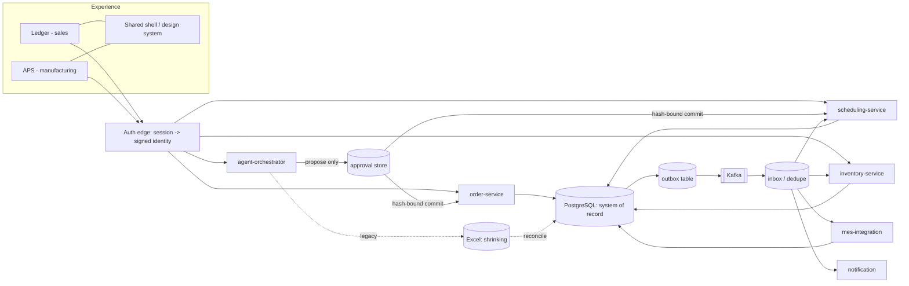
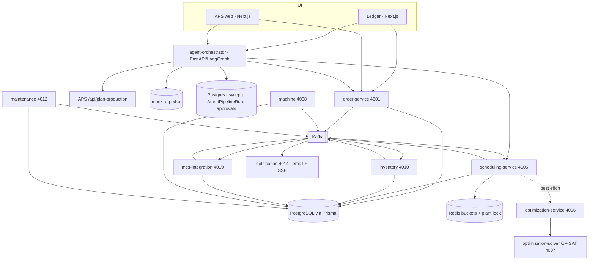
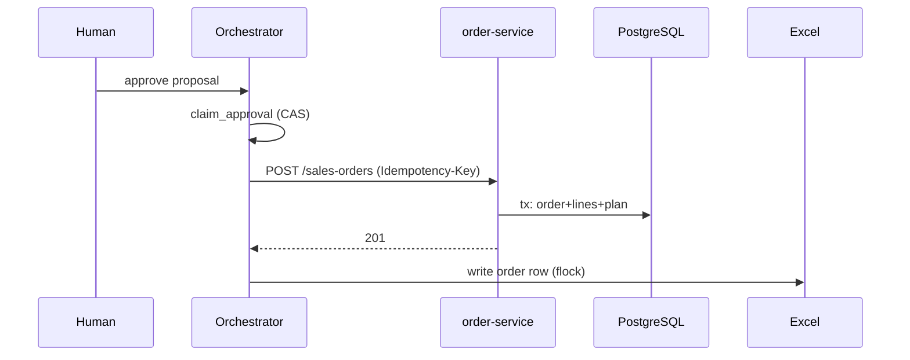

---

<!-- SOURCE: README.md -->

# Investigation: Ledger + APS vs. Oracle Fusion SCM, and engineering maturity

Status: **FINDINGS FOR REVIEW. No production code was changed, nothing staged or committed.**
Only files under `docs/investigation/` were added.

## Evidence basis and limits (read first)

| Item | Basis |
|---|---|
| Repo state | HEAD `e65a291` plus the dirty working tree (18 modified files and 3 untracked, left untouched). |
| Method | Static reading of schema, services, contract, CI, tools and tests, plus targeted greps. Counts such as "547 pytest tests" are `def test_` counts and were **not executed** (the memory note on pytest corrupting `mock_erp.xlsx` applies). |
| Not done | **No load tests, no scheduler benchmarks, no live failure injection, no UI walkthrough.** Every performance, scalability and "beats Oracle" statement is therefore a hypothesis or a proposed test, never a result. |
| Oracle evidence | **Only one Oracle page was actually read**: the SCM AI feature index, `docs.oracle.com/.../aiafl/ai-scm.html`. It gives feature name, release (25A to 26D) and type (AI agent / Agentic app / Predictive AI / "Fusion Claw") and says nothing about autonomy or approval behavior. The per-feature readiness pages, the SCM playbooks, the Architecture Center and the other vendors (SAP, Siemens, Kinaxis and so on) were **not read**. Anything about them is labeled `UNVERIFIED (from general knowledge)` and must be checked before it is used in a sales or strategy decision. |
| Prior docs | `ARCHITECTURE_BASELINE.md` is dated Oct 5 and is partly stale. For example, it says `publish()` has no catch, but `publishTracked` now exists. It is used here only as a lead, and every claim reused was re-checked against HEAD or is marked as unchecked. |

## Labels used

`VERIFIED` = seen in source at HEAD. `INFERRED` = follows from verified code but was not run. `UNVERIFIED` = not checked. `PROPOSED` = new work. `HYPOTHESIS` = needs customer or benchmark validation.

## Documents

Commercial / product set (Parts 1 to 11):
1. [oracle_scm_product_reverse_engineering.md](oracle_scm_product_reverse_engineering.md)
2. [oracle_agentic_vs_deterministic_analysis.md](oracle_agentic_vs_deterministic_analysis.md)
3. [current_product_capability_audit.md](current_product_capability_audit.md)
4. [oracle_vs_our_product_comparison.md](oracle_vs_our_product_comparison.md)
5. [agentic_architecture_recommendation.md](agentic_architecture_recommendation.md)
6. [competitive_differentiation_strategy.md](competitive_differentiation_strategy.md)
7. [enterprise_engineering_gap_analysis.md](enterprise_engineering_gap_analysis.md)
8. [target_product_architecture.md](target_product_architecture.md)
9. [product_roadmap.md](product_roadmap.md) (contains the top 10 and the final Q&A)
10. [validation_and_acceptance_criteria.md](validation_and_acceptance_criteria.md)

Architecture set (Part 12):
`system_architecture_current_state.md`, `target_system_architecture.md`, `domain_model_and_bounded_contexts.md`, `distributed_systems_failure_analysis.md`, `database_and_data_consistency_review.md`, `api_and_integration_architecture.md`, `reliability_and_resilience_assessment.md`, `security_architecture_review.md`, `performance_and_scalability_assessment.md`, `aps_engine_architecture_review.md`, `software_engineering_quality_assessment.md`, `frontend_architecture_review.md`, `agentic_systems_engineering_review.md`, `architecture_decision_records/`, `engineering_maturity_roadmap.md` (contains the Part 12.15 answers).

## Headline findings (one screen)

1. The architecture is **sound in its core choices and weak in its plumbing**. The shared Postgres domain, a single authoritative scheduler, HTTP-to-deterministic-tool agents, signed identity assertions and an enforced architecture contract are all good. There is **no outbox, no inbox or consumer dedupe, no dead-letter handling, no circuit breaker, no metrics or tracing, and no CI beyond the architecture contract.**
2. **Excel (`mock_erp.xlsx`) is still a source of truth** for much of the post-sales domain, with Postgres dual-writes for Delivery and Invoice. Atomicity is explicitly not claimed. This is the largest data-consistency risk.
3. **Multi-factory and multi-tenant is blocked**: `Product` has no `enterpriseId` and `sku` is globally unique. Stock reservation is a single counter, `Inventory.qtyReserved`, with no reservation ledger.
4. **The scheduler is a real finite-capacity, rule-based engine** (dispatch rules, shifts, holidays, alternative work centers, a planning fence, a plant lock). It is **not** a constraint optimizer. Sequence-dependent changeover is not used in the core pipeline. The CP-SAT path models only machine no-overlap, precedence and makespan, and is currently undeployable here. No benchmark exists, so no superiority claim is possible.
5. Oracle's catalogue is mostly **assistive agents plus command-center workspaces**. We cannot verify from the index page how autonomous they are. Our realistic edge is **order-to-production coherence in one workspace with deterministic promise math and explainable recovery**. That is a hypothesis to validate, not a finding.

---

<!-- SOURCE: oracle_scm_product_reverse_engineering.md -->

# Oracle Fusion SCM: product findings

**Honesty note.** Only one Oracle source was read in this investigation (the SCM AI feature index). Part 3 of the brief asks for 17 questions per workflow (data read and written, state transitions, validations, recovery). **That cannot be answered from the index page, and I did not fetch the ~260 per-feature readiness pages, the SCM integration playbooks or the product pages.** This document therefore has two parts. The first is verified, from the index. The second is a research plan with the questions to answer, plus clearly labeled `UNVERIFIED` general knowledge, so nobody mistakes it for evidence.

Source: https://docs.oracle.com/en/cloud/saas/fusion-ai/aiafl/ai-scm.html (fetched 2026-10-30).

## 1. VERIFIED: what Oracle's AI index shows

The page lists features from release 25A through 26D, tagged **AI agent**, **Agentic app**, **Predictive AI** or **Fusion Claw** (an undefined label used on 4 items: Procurement Spend Command Center, Sourcing Command Center scenario simulation, Shipment Load Planning Workspace, Supply Planning Allocation Workspace; all 26D). It lists about 260 entries (dozens of agents, 15 or so agentic apps, and the rest predictive AI or enhancements).

Relevant entries for our scope, with module and release exactly as listed:

| Oracle item | Module | Type | Release |
|---|---|---|---|
| Sales Order Assistant | Order Management | AI agent | 25D |
| Order Exception Assistant (+ enhancements) | Order Management | AI agent | 25D, 26A, 26C |
| Purchase Orders to Sales Orders Converter (+ via email) | Order Management | AI agent | 25D/26A, 26C |
| Sales Order Correction Assistant | Order Management | AI agent | 26C |
| Sales Order Command Center | Order Management | Agentic app | 26B, 26C/26D |
| Inventory Reservation Assistant (+ proactive recommendations) | Inventory Mgmt | AI agent | 26A, 26C |
| Inventory Shortages Assistant | Inventory Mgmt | AI agent | 26B |
| Inventory Planning Command Center | Demand Mgmt | Agentic app | 26C |
| Work Order Completion Assistant | Manufacturing | AI agent | 26B |
| Work Order Sync Assist | Manufacturing | AI agent | 26A |
| Operations Assignment Assistant | Manufacturing | AI agent | 26A |
| Disposition Assistant for Rejects | Manufacturing | AI agent | 25D |
| Production Shift Operations Workspace (+ enhanced advisors) | Manufacturing | Agentic app | 26B, 26C |
| Production Readiness Workspace | Manufacturing | Agentic app | 26C |
| Planning Advisor for Exceptions | Supply Planning | AI agent | 25D |
| Planning Order Release Assistant (+ batch, + root cause) | Supply Planning | AI agent | 26A, 26B, 26C |
| Autonomous Sourcing Assistant (+ enhancements) | Procurement | AI agent | 26A, 26B |
| Sourcing Command Center | Procurement | Agentic app | 26B |
| Supplier Qualification Workspace | Procurement | Agentic app | 26C |
| Quality Inspection Standards Advisor | Quality | AI agent | 25C |
| Quality Assurance Workspace | Quality | Agentic app | 26D |
| Maintenance Advisor / Work Order Builder / Maintenance Operations Workspace | Maintenance | AI agent / Agentic app | 25C, 25D, 26B |

**Observations that follow directly from the index:**
- The pattern is **many narrow, role-specific assistants per module, plus one workspace ("command center") per role**. It is not one big agent.
- The names are overwhelmingly advisor, assistant or guide. Only one carries "Autonomous" in its name: Autonomous Sourcing Assistant. **Whether any of these execute without approval is not stated on the index page. Do not infer it either way.**
- **Scheduling itself is not in the list.** Production scheduling and planning math do not appear as agents. The planning items are about exceptions, notes, order release and process advice around the planning engine. This is consistent with "agents sit around a deterministic engine", but it is only consistent with that. It does not prove it.
- Predictive AI is used in a few narrow places (classification code proposal, ETA, route prediction, slotting). These are the cases where a statistical or ML model is the right tool.

## 2. UNVERIFIED: general knowledge (check before use)

These are widely understood properties of Oracle Fusion SCM and have not been checked in this session:
- The order-to-cash chain runs through Order Management with Global Order Promising (ATP/CTP), Order Orchestration (Supply Chain Orchestration), Inventory, Shipping and Receivables.
- Manufacturing uses Work Definitions (BOM and routing together), work orders and shop-floor execution, and a separate planning application (Supply Planning, which handles constraints, with scheduling inside Manufacturing or Planning).
- Integration is through REST and SOAP services, FBDI file import, business events and OIC playbooks.

## 3. Research plan for the remaining Part 3 questions (needed before any Oracle claim in a customer-facing document)

| Priority | Page set | Question it settles |
|---|---|---|
| 1 | Readiness pages for Order Exception Assistant, Sales Order Assistant, Inventory Reservation Assistant, Work Order Completion Assistant, Planning Order Release Assistant, Autonomous Sourcing Assistant | Which ones **execute** transactions, which only recommend, what approval or confirmation step exists |
| 2 | Sales Order Command Center and Production Shift Operations Workspace guides | Role, data shown, actions available from the workspace |
| 3 | Global Order Promising and Supply Planning guides | How promise dates and plan exceptions are computed (deterministic vs. ML) |
| 4 | SCM integration playbooks overview (URL in the brief) | Integration style and the objects exchanged |
| 5 | Architecture Center / Fusion Applications architecture pages (Part 12 references) | Real reference architecture; decide what is applicable at our scale |

Competitors (SAP, Siemens Opcenter, PlanetTogether, Dynamics 365, Epicor, Infor, Odoo, Kinaxis, o9): **not researched.** PlanetTogether and Kinaxis are the most relevant benchmarks for the APS and exception-management claims. Research them before making any claim about scheduling quality.

---

<!-- SOURCE: oracle_agentic_vs_deterministic_analysis.md -->

# Oracle capabilities: agent / predictive / deterministic / agentic app

Source: the Oracle SCM AI feature index (see [oracle_scm_product_reverse_engineering.md](oracle_scm_product_reverse_engineering.md)). That page gives **type labels only**. Autonomy, approval and determinism below are therefore marked as either *labeled by Oracle* or *our reading*. Nothing here asserts how an Oracle agent behaves at runtime.

## Oracle's own taxonomy (VERIFIED, from the index)

| Oracle label | Meaning as used on the page | Examples |
|---|---|---|
| AI agent | A single-purpose assistant embedded in a module, usually named "Assistant", "Advisor" or "Guide" | Order Exception Assistant, Work Order Completion Assistant, Planning Order Release Assistant |
| Agentic app | A role workspace ("Command Center", "Workspace") that hosts several agents/advisors | Sales Order Command Center, Production Shift Operations Workspace, Sourcing Command Center |
| Predictive AI | Embedded ML | Product classification code proposal, planned shipment ETA, order route prediction, predictive slotting |
| Fusion Claw | Undefined on the page (4 items, all 26D) | Procurement Spend Command Center, Supply Planning Allocation Workspace |

## Our reading by capability class (HYPOTHESIS until per-feature pages are read)

| Capability class | Likely deterministic core (not an agent) | Agent role (our reading) | Evidence strength |
|---|---|---|---|
| Order promising, ATP/CTP | Promise computation | Explain, recommend alternatives | Low: not read |
| Order exceptions | Exception detection | Triage, suggest recovery, draft corrections | Medium: the name and the 25D-to-26C enhancement sequence ("Improve responses, extensions, exceptions, and recovery") |
| Inventory reservation / shortages | Reservation and stock accounting | Recommend reservations ("View Proactive Recommendations", 26C) | Low |
| Work order completion / sync | Completion transaction | Guide data entry, sync assist | Low |
| Production scheduling | Planning/scheduling engine | Absent from the AI index as an agent | Medium (absence in the index) |
| Sourcing | Award math | "Autonomous Sourcing Assistant" is the only name implying autonomy; **degree unknown** | Low |
| ETA, route, slotting | n/a | Predictive ML, not LLM agents | Medium (labeled Predictive AI) |

## What this means for us (design implications, not claims about Oracle)

1. A one-agent-per-narrow-task, plus-workspace shape is the market pattern. It matches our direction of verdict-writer agents plus a command-center UI, and does not argue for more agents.
2. Because the index does not describe autonomy, **our product must not market "more autonomous than Oracle"**. We cannot show it, and our own principle (humans approve consequential actions) points the other way.
3. Predictive AI is correctly separated by Oracle from LLM agents. We should do the same: ETA, delay and shortage risk should be statistical models or deterministic rules, not LLM calls.

Next step to turn hypotheses into findings: read the readiness page for the six priority features listed in the reverse-engineering doc, section 3.

---

<!-- SOURCE: current_product_capability_audit.md -->

# Current product capability audit (HEAD `e65a291` + dirty tree)

Scale (VERIFIED by file counts): 18 services under `services/`, Prisma schema of 1,587 lines and 59 models with 34 migrations, two Next.js apps (Ledger = `frontend/`, about 8.6k lines; APS = `web/`, about 11.4k lines), and the Python agent-orchestrator (`app/graph.py` alone is 3,322 lines, with 24 agent modules and 26 tool modules).

Status legend: **Complete** (schema + logic + tests seen), **Partial**, **Thin** (exists, shallow), **Absent**. "Tests" is a static count of test functions; none were run for this audit.

## A. Ledger / commercial

| Capability | Status | Evidence | Gap |
|---|---|---|---|
| Customer, SalesOrder, OrderLine, FulfillmentPlan/Line | Complete | `schema.prisma` models; atomic creation in one `$transaction` (contract A2); order-service has 99 test cases | `Customer` is also written by erp-integration (documented exception) |
| Fulfillment strategies (MTS etc.), HYBRID | Complete (model), Partial (decision) | `enum FulfillmentStrategy`; agent decides | The decision is made by an LLM agent (baseline of Oct 5). The current gate **was not re-verified at HEAD**; `fulfillment_agent.py` only says amounts are computed elsewhere |
| Credit validation | Complete | `tools/credit_tools.py`, `test_credit*.py` | Excel-backed |
| Promise date + Promise Risk Inbox | Complete | order-service `/sales-orders/promises`; scheduling `checkPromiseImpact` (`pipeline.ts:177`); promise-impact tests | |
| Delivery and invoice | Partial | Postgres `Delivery`/`Invoice` dual-write from Excel (`delivery_tools.py`, `billing_tools.py`); `postgres_synced` flag; "never claimed atomic" | Two stores; reconciliation absent |
| Returns, consignment, export, project, service, subscription | Present in Excel/agents | `post_sales_tools.py`, `consignment_tools.py`, `export_tools.py`, etc. | Excel-only domain, outside Postgres |
| Approval workflow | Complete | `approval_proposal.py` (hash-bound proposal), atomic CAS `claim_approval`, STALE state; immutable proposal migration; contract D1 | |

## B. APS / manufacturing

| Capability | Status | Evidence | Gap |
|---|---|---|---|
| BOM, routing, operations, dependencies | Complete | models `BOM`, `BOMLine`, `Routing`, `RoutingOperation`, `RoutingOpDependency` | routing-service has **no tests**, 139 lines |
| Machines, work centers, calendars, shifts, holidays | Complete | models + calendar migrations (shift expansion, holiday calendar, work-center override) | |
| Production orders, status lifecycle | Complete | `ProductionOrderStatus` DRAFT→PLANNED→RELEASED→IN_PROGRESS→COMPLETED/CANCELLED | Transition enforcement location not enumerated |
| Finite-capacity scheduling | Complete (rule-based) | `pipeline.ts`: forward/backward/bottleneck modes, dispatch rules EDD/SPT/LPT/CR/ATCS/PRIORITY_SCORE (`dispatch-rules.ts`), capacity buckets in Redis, alternative work centers, 13-week horizon extendable to 26 weeks, 24h planning fence, per-plant Redis lock with fencing | Setup time is a flat per-op cost (`pipeline.ts:662`); sequence-dependent changeover is **not** in the core pipeline |
| SINGLE / AFFECTED / ALL rescheduling | Complete | `resolveScopedOrderIds` (`pipeline.ts:104`); `pipeline.affected-scope.test.ts` | ALL is a scope, not a different algorithm |
| What-if / recovery simulation | Complete | `DryRunCtx`; `pipeline.recovery-whatif.test.ts` | |
| Schedule versioning, audit, idempotency | Complete | `Schedule`, `ScheduleRun`, `ScheduleAuditLog`, `IdempotencyKey` (+ request hash) | Audit rows lack traceId on publish failure (contract known_exception) |
| Material check at placement | Partial | `checkOperationMaterial` (`pipeline.ts:1549`) | Material is checked at placement, not a netted MRP |
| Execution, good/scrap, finished-goods receipt | Complete | `ProductionCompletionStep`; `actualGoodUnits/actualTotalUnits`; atomic claim; mes-integration (16 tests) | |
| Quality inspection | Complete | `QualityInspection`; execution-time predecessor gate (memory milestone) | Rework/NCR/disposition flow absent |
| Production exceptions, OEE downtime | Complete (per memory) | `ProductionException` with `resolvedAt` | OEE ClickHouse leg untested (no Docker) |
| Materials lifecycle | Partial | `InventoryMovement` types are only GOODS_RECEIPT and GOODS_ISSUE | No reservation entity; `Inventory.qtyReserved` is a counter |
| Procurement | Partial | `Vendor`, `VendorProduct`, `PurchaseOrder` | No requisition, no supplier delay model |
| Maintenance | Thin | `MaintenancePlan`/`MaintenanceOrder`; 168-line service; one test file | |
| Optimization (CP-SAT) | Thin and not deployed | `optimization-solver/main.py`; Dockerfile states "not built/run" | See [aps_engine_architecture_review.md](aps_engine_architecture_review.md) |

## C. Agentic workflows

Verified: ORDER_PROMISE and PROMISE_RECOVERY flows, intent classification, capability selection (`capabilities/registry.py`), human approval gating, trace correlation (`trace_context.py`). There are **547 `def test_` functions** across 61 test files in agent-orchestrator. There are **no LLM evaluation datasets, no prompt versioning and no golden sets** (grep for `eval_dataset|golden|langsmith|prompt_version` returned nothing).

## Cross-cutting findings

- **Test layout**: orchestrator and order-service are well tested. Fifteen of 18 services have zero or one test file. The only CI workflow is the architecture contract (VERIFIED: `.github/workflows/` has one file). **Tests are not run in CI.**
- **Observability**: no Prometheus, OpenTelemetry or Sentry anywhere (0 files). Health endpoints exist in 8 files, readiness in 2. Trace IDs are propagated through logs only.
- **Docs vs. reality**: `docker-compose.yml` and k8s manifests are config-only and were never run ("Docker is not installed"). The orchestrator and Ledger have no Dockerfile.
- **Unverified at HEAD**: whether 17 pre-existing orchestrator test failures from the Oct 5 baseline still fail; per-handler idempotency of 8 Kafka consumers.

---

<!-- SOURCE: oracle_vs_our_product_comparison.md -->

# Oracle vs. our product

**Read the limits first.** Oracle's side is based on the AI feature index only (a name/type/release list). Its cells below say what the index shows, not what the feature does. Rows where Oracle's behavior is unknown are marked `?`. Do not quote this in a customer deck without the research in [oracle_scm_product_reverse_engineering.md](oracle_scm_product_reverse_engineering.md) §3.

Labels: **[O-V]** verified Oracle listing, **[O-?]** Oracle behavior not verified, **[OURS-V]** verified in our code, **[NEW]** proposed, **[HYP]** hypothesis needing validation.

## Capability table

| Opportunity | Oracle capability | Our capability | Gap | Proposed improvement | Why it could be better | Difficulty |
|---|---|---|---|---|---|---|
| Order exceptions | Order Exception Assistant, 25D→26C [O-V name]; depth [O-?] | Promise Risk Inbox, `ProductionException`, Late/At-Risk list, ScheduleAuditLog [OURS-V] | Exceptions live on separate screens | One cross-domain exception command center [NEW] | Single workspace for order→plan→machine→material [HYP] | M |
| Order promising | Sales Order Assistant / Command Center [O-V names]; Global Order Promising [O-?] | Deterministic `checkPromiseImpact`, ORDER_PROMISE agent, approval-bound proposals [OURS-V] | Predictive risk model absent | Risk scoring from schedule slack plus supplier/machine history [NEW] | Explainable and replayable [HYP] | M |
| Inventory reservation | Inventory Reservation Assistant (+ proactive recs) [O-V name] | `qtyReserved` counter only [OURS-V] | **No reservation entity** | `StockReservation` ledger with lifecycle [NEW] | Prerequisite for any reservation agent | M |
| Shortages | Inventory Shortages Assistant [O-V name] | Inventory agent verdict-writer, vendor data (memory milestones) [OURS-V] | Supplier lateness not modeled | Shortage forecast from POs and schedule [NEW] | Deterministic first | M |
| Work-order completion | Work Order Completion Assistant [O-V name] | Atomic completion, scrap-aware, FG receipt [OURS-V] | Operator UI is not mobile-first | Mobile operator completion [NEW] | We already own correct semantics | M |
| Quality / rejects | Disposition Assistant for Rejects [O-V name] | Pass/fail inspection and predecessor gate [OURS-V] | No NCR/disposition/rework | Disposition workflow [NEW] | Needed for real shop floor | M-L |
| Scheduling quality | Not shown as agent [O-V absence]; engine [O-?] | Rule-based finite-capacity engine [OURS-V] | **No benchmark** | Benchmark harness first [NEW] | Evidence before claim | M |
| Sequence-dependent setup | Standard in APS class [O-?] | Flat setup per op in pipeline; matrix only in TSP service [OURS-V] | Gap | Use `ChangeoverMatrix` in placement [NEW] | Material for mixed-product lines | L |
| Planning order release | Planning Order Release Assistant [O-V name] | PROMISE_RECOVERY approval path [OURS-V] | No MRP-style planned-order layer | Defer | Low evidence | L |
| Sourcing / procurement | Autonomous Sourcing Assistant, Sourcing Command Center [O-V names] | `VendorProduct` shortage purchasing [OURS-V] | No RFQ/award | **Do not build** now | Out of ERP-for-MTO focus | XL |
| Maintenance | Maintenance Advisor / WO Builder [O-V names] | Breakdown → reschedule chain [OURS-V] | Predictive maintenance absent | Defer | Needs sensor data | L |
| Unified experience | Per-role workspaces inside module boundaries [O-V names] | Two apps: Ledger and APS, no common shell [OURS-V] | Fragmented | Order-lifecycle timeline across both apps [NEW] | Our biggest plausible edge [HYP] | M |
| Reliability engineering | Mature SaaS [O-?] | Idempotency, plant lock, fencing, CAS approvals [OURS-V]; **no outbox/DLQ/metrics** | Large | Foundation work (see roadmap) | Required for pilot | M |

## Where we are at comparable functional level (qualified)

[OURS-V] core order→fulfillment→production→completion lifecycle with real state and tests; approval gating with proposal-hash binding; promise-risk detection; rescheduling scopes. "Comparable" here means *the function exists*. Depth, scale and certification are not comparable and untested.

## Where Oracle is clearly ahead (even without full research)

Breadth (about 260 AI entries across 20 or so modules), enterprise controls, multi-site/multi-entity, localization, security certification, ecosystem. These are not closable by a small team and should not be goals.

## Where we could be different, not necessarily better

1. A single order-to-production timeline and exception inbox (needs user validation).
2. Deterministic, replayable promise recovery with hash-bound approval.
3. Lightweight, fast deployment for mid-size discrete manufacturers (HYP).

---

<!-- SOURCE: agentic_architecture_recommendation.md -->

# Where to use agents, and where not to

Principle (matches `architecture/contract.yaml` B2/C1/C2/C3/D1): **the LLM is never the source of truth for data or feasibility, and never commits a mutation directly.** Everything authoritative is a deterministic service; consequential actions need a human approval bound to the exact proposal.

## 1. Classification

Classes: **D** deterministic, **P** predictive (statistical/ML/optimization), **A** agentic (LLM reasons over tools), **H** hybrid, **HA** human approval required.

| Capability | Class | Why |
|---|---|---|
| Credit validation | D | Pure rule; auditable; money |
| Inventory accounting, stock reservation | D | Ledger integrity; races (see audit commits on double reservation) |
| Order state transitions, approval enforcement, idempotency, audit | D | Invariants |
| BOM/routing validation, quantity and scrap math | D | Arithmetic |
| Machine capacity, scheduling feasibility | D | Must be provable; `pipeline.ts` + `schedule-validator.ts` |
| Schedule generation | D (rules) now; P (optimization) later if benchmarks justify | See APS review |
| Promise-date computation | D | `checkPromiseImpact` |
| Promise risk early warning | P | Slack/lateness statistics; no LLM needed |
| Demand forecast, ETA, delay, shortage, quality defect, machine failure | P | Time-series/classification; LLM is the wrong tool; **needs data volume we may not have** (HYP) |
| Free-text order understanding (PO email, ambiguous request) | A | Genuinely ambiguous input; output goes to a *proposal* validated deterministically |
| Intent classification / capability selection | A, with deterministic fallback | Already built; keep with fixed enum outputs |
| Fulfillment strategy choice (MTS/MTO/BUY/…) | **H**: deterministic rules decide; LLM explains | Baseline reported this as LLM-decided; re-verify and move to rules if still true |
| Vendor selection for shortage | H: deterministic ranking on `VendorProduct` cost/lead time; LLM explains | Real financial commitment |
| Recovery option generation | H: engine produces feasible options via what-if; LLM ranks/explains | Feasibility must come from the engine |
| Cross-domain root-cause narrative | A over deterministic evidence | LLM adds value only as explanation |
| Recovery execution, PO creation, reschedule commit, order creation from documents | HA | Consequential |
| Delay/inventory/quality verdict explanation | A (read-only verdict writers, already built) | Low risk |

## 2. The ten candidate agents: build, defer, or reject

Existing verified agents: intent, capability selector, request understanding, context, fulfillment, promise options, production planning, scenario comparison, inventory, quality, procurement, plus the Ledger sales-channel agents.

| # | Candidate | Decision | Rationale |
|---|---|---|---|
| 1 | Sales Order Intelligence (document → order draft) | **Build next, narrow** | Ambiguous input. Output is a draft that deterministic validation checks and a human approves |
| 2 | Order Promise | Keep | Exists; make rules authoritative |
| 3 | Promise Recovery | Keep | Exists; engine-generated options |
| 4 | Production Planning Intelligence | Keep as explainer | Verdict clamped by deterministic facts (verified pattern) |
| 5 | Scheduling Intelligence | **Reject as agent** | Scheduling is an optimization problem. Add a benchmarked solver and explanations, not an LLM |
| 6 | Inventory Intelligence | Keep read-only | Verdict writer |
| 7 | Procurement Intelligence | Defer | Needs supplier delay data. Rules first |
| 8 | Quality Investigation | Defer | NCR/disposition workflow must exist first |
| 9 | Maintenance Intelligence | Defer | Needs sensor data |
| 10 | Production Shift Operations | **Not an agent**: a deterministic dashboard/workspace first | Fewer clicks beats chat |

## 3. Per-agent contract (apply to every agent we keep)

| Field | Required content |
|---|---|
| Trigger | Named event or user intent; never autonomous loops without a policy |
| Inputs / context | IDs, not blobs; deterministic facts fetched through typed tools |
| Tools | Allow-list per agent; read tools by default |
| Write permissions | **Propose only.** Writes go through the approval service which re-validates the proposal hash and current state (contract D1) |
| Actions needing approval | All writes with money, inventory, or schedule effect |
| Failure/retry | Bounded retries on reads; writes carry idempotency keys; on exhaustion return a deterministic "unable to evaluate", not a guess |
| Audit | Run id, tool calls, inputs and outputs hash, model/prompt version (**prompt version not tracked today**) |
| Metrics | Task success, factual accuracy vs. deterministic ground truth, policy violations (target 0), action correctness, p95 latency, cost per run |

## 4. Must-do before adding any agent

1. Build an **agent evaluation set** (none exists): 50 to 100 labeled cases per workflow with a deterministic ground truth.
2. Add prompt/model versioning to `AgentPipelineRun`.
3. Re-audit the nine unclassified agents named in the Oct 5 baseline (configuration, export, consignment, financial, service, subscription, project, billing, post-sales) for any LLM output that reaches a write without a deterministic check. **Status at HEAD: unchecked.**

## 5. Deliberately not building

Agents for scheduling, accounting, reservations, credit; autonomous execution of procurement or schedule commits; an agent per Oracle assistant; multi-agent "swarm" coordination. The stated multi-agent phase 8 already runs as deterministic composition plus read-only verdict writers, which is the right shape.

---

<!-- SOURCE: competitive_differentiation_strategy.md -->

# Competitive differentiation: realistic opportunities

No claim below is "better than Oracle". Each is a **hypothesis with the evidence required to confirm or kill it**.

| # | Opportunity | Basis today | Evidence needed | Verdict |
|---|---|---|---|---|
| D1 | **Unified order-to-production workspace** (customer order, promise, production plan, machine, material, delivery on one timeline) | Data already in one Postgres schema; two separate apps | Task-time study: users resolve a late order in fewer steps than a reference baseline we define. **No Oracle baseline measured** | Best candidate |
| D2 | **Explainable promise recovery** (engine-generated options, hash-bound approval, replayable) | Verified: what-if engine, dry-run, immutable proposals, audit log | Pilot: percent of recoveries accepted without edit; time to decision | Strong, partially built |
| D3 | **Cross-order impact analysis** (a machine breakdown to affected orders to customers to promise risk) | Verified: breakdown→reschedule consumer, `AFFECTED` scope, promise-impact detection | Demonstrate on seeded breakdown scenario with measured latency | Strong, needs UI |
| D4 | **Schedule quality** | Rule-based engine only | Benchmarks on makespan, tardiness, stability, runtime vs. dispatch baselines and CP-SAT | **Do not claim** until measured |
| D5 | **Lower operating complexity / fast deployment** | Small team; 18 services is not lightweight, though they share one DB | Time-to-first-schedule for a new site | Hypothesis; consolidation may help |
| D6 | **Conversational operations** | Agent console exists | Task completion vs. forms | Low differentiation (Oracle ships many assistants) |
| D7 | **Mobile operator experience** | Absent | Operator trials | Valuable, not unique |

## Honest competitive position

- **Do not compete on breadth.** Oracle's index alone lists around 260 AI entries across 20 or so modules.
- **Compete on a vertical slice**: discrete/make-to-order manufacturers that need order promising tied to finite-capacity schedule recovery.
- Closest functional benchmarks for the APS slice are specialized planners (PlanetTogether, Kinaxis). **Not researched here.** Research before positioning.

## Prerequisites for any of these to be credible

1. Reliability foundation (outbox, consumer dedupe, DLQ, metrics): a "unified" view that shows inconsistent data destroys trust.
2. A scheduler benchmark and a recorded baseline.
3. A real pilot customer to validate D1 and D2. All "value" statements here are unvalidated until then.

---

<!-- SOURCE: enterprise_engineering_gap_analysis.md -->

# Engineering gap analysis

Each gap lists severity (S1 pilot-blocking, S2 production-blocking, S3 scale-blocking), evidence and an acceptance criterion. See [validation_and_acceptance_criteria.md](validation_and_acceptance_criteria.md) for how each is tested.

| ID | Area | Gap | Sev | Evidence | Acceptance criterion |
|---|---|---|---|---|---|
| G1 | Reliability | No transactional outbox. Kafka publish happens after the DB commit (`publishTracked` avoids the 500 but **the event is lost** on failure) | S1 | `packages/shared/src/kafka.ts:37`; grep for "outbox" = 0 | Kill broker during 1,000 writes: 0 lost events after recovery |
| G2 | Reliability | Consumers: no dedupe (only `scheduling-service-breakdown` reads an `eventId`), no DLQ, no retry policy beyond kafkajs defaults; `subscribe()` has no try/catch around handlers | S1 | `kafka.ts:subscribe`; no DLQ matches | Replay every event twice: final state identical; poison message lands in DLQ and does not block the partition |
| G3 | Data | Excel is a live source of truth for post-sales; Postgres dual-write is best effort | S1 | `delivery_tools.py` `postgres_synced`; billing similarly | Nightly reconciliation reports 0 unexplained diffs; each entity has one declared system of record |
| G4 | Multi-tenant | `Product` is global (`sku @unique`, no `enterpriseId`) | S3 | `schema.prisma:374` | Two enterprises create the same SKU independently |
| G5 | Data | Stock reservation is a counter; `InventoryMovement` types are only GOODS_RECEIPT/GOODS_ISSUE | S2 | `schema.prisma:1117,1202` | Every reserved unit traceable to an order line; sum(reservations) = `qtyReserved` |
| G6 | Observability | No metrics, no tracing backend; logs only | S2 | grep for prometheus/otel/sentry = 0 | Dashboard with per-service request rate, error rate and p95; one trace across Ledger→orchestrator→order-service→scheduling |
| G7 | CI | CI runs only the architecture contract; no unit/integration tests | S1 | `.github/workflows/` has 1 file | PR gate runs all suites against Postgres + Redis (+ Kafka for integration) |
| G8 | Resilience | No circuit breaker/bulkhead; retries in orchestrator only (`order_domain.py`, up to about 47s backoff) | S2 | grep for circuit = 0 | Downstream outage does not exhaust orchestrator workers |
| G9 | Security | Shared secret for all internal calls; `routeAuth.ts` compares tokens with `===` | S2 | `routeAuth.ts` | Per-service credentials/mTLS plan; constant-time compare |
| G10 | Security | No rate limiting or security headers on services; CORS only on the agent-orchestrator (single hardcoded origin), none on Node services | S2 | grep | Gateway or middleware in place |
| G11 | Scheduler | No benchmark or KPI record; changeover not in pipeline | S2 | [aps review](aps_engine_architecture_review.md) | Benchmarks in CI with regression thresholds |
| G12 | Agents | No eval datasets or prompt versioning | S2 | grep = 0 | Eval run on each prompt change; thresholds in [validation](validation_and_acceptance_criteria.md) |
| G13 | Operability | Orchestrator and Ledger have no Dockerfile; compose never run | S2 | `project_docker_compose_gap` memory and files | Reproducible start with a documented runbook |
| G14 | Tests | 15 of 18 services with 0 or 1 test file; pre-existing failing tests not triaged | S2 | file counts | Triaged; zero known-red tests |
| G15 | DR | No backup/restore or RPO/RTO defined | S1 | none found | Restore drill passes within RTO |

Items that are **not** gaps (verified good): tenant-scoped identity assertions (HMAC, audience-bound, 60s TTL), DB exclusion constraint against overlapping reservations, hash-bound approvals, scheduler per-plant lock with fencing, idempotency keys with request hash, architecture contract in CI.

---

<!-- SOURCE: target_product_architecture.md -->

# Target product architecture (evolution, not rewrite)

Constraints: keep the shared Prisma domain, the single scheduler, the agent-orchestrator and both Next.js apps. Add no new microservice unless justified (none proposed).

## Changes, in order

1. **Outbox and inbox in `packages/shared`**: services write an `OutboxEvent` in the same transaction as the domain write; a relay publishes. Consumers record `(consumer, eventId)` in an inbox table; failures after N attempts go to a DLQ topic. This directly fixes G1/G2. Shared package, not a service.
2. **Single system of record per entity** (see [domain model](domain_model_and_bounded_contexts.md)). Postgres wins; Excel becomes import/legacy adapter and eventually a read-only mirror. Nightly reconciliation job as the first step.
3. **Reservation ledger**: `StockReservation` plus new `InventoryMovementType` values; `qtyReserved` becomes a derived/maintained value.
4. **Tenant model**: add `enterpriseId` to `Product` (or a per-enterprise product table), `siteId` scoping for plants. Required before a second factory/tenant.
5. **Scheduler**: keep `pipeline.ts` as authority. Add benchmark harness, then sequence-dependent setup; evaluate CP-SAT only as a *verified* refinement (feasibility re-checked by `schedule-validator.ts`).
6. **Observability**: OpenTelemetry in `packages/shared` and the orchestrator; Prometheus metrics endpoint; health/readiness uniform.
7. **Experience**: shared design tokens/component package; an order lifecycle timeline and an exception command center served from existing APIs; apps stay separate.
8. **Agents**: propose-only; eval harness; prompt/model version recorded per run.

## Explicitly not in the target

More microservices, event sourcing, CQRS, a service mesh, a custom workflow engine, Kubernetes as a prerequisite (manifests exist but are unrun), LLM-driven scheduling.

---

<!-- SOURCE: product_roadmap.md -->

# Product roadmap and final answers

Estimates are engineer-weeks for one experienced engineer, rough (±50%), not commitments. "Pilot" = suitable for a controlled single-site pilot.

## Top 10 improvements (ranked)

| # | Improvement | Level | Value | Current gap | Depends on | Code areas | Effort | Pilot |
|---|---|---|---|---|---|---|---|---|
| 1 | **Outbox + idempotent consumers + DLQ** | 1 | No lost or double-applied events | G1/G2 | none | `packages/shared/src/kafka.ts`; new `OutboxEvent`, `InboxEvent` models; producers in order/scheduling/machine/inventory/mes/maintenance; 4 scheduling consumers | 3-4 | Yes |
| 2 | **CI that runs tests** (Postgres + Redis services; per-service suites; orchestrator pytest serialized) | 1 | Regression safety | G7/G14 | none | `.github/workflows/` | 1-2 | Yes |
| 3 | **Single system of record + reconciliation** for Delivery, Invoice, then SalesOrder-linked post-sales | 1 | Removes the biggest consistency risk | G3 | none | `tools/delivery_tools.py`, `billing_tools.py`, `integrations/order_domain.py`; new reconcile job | 3 | Yes |
| 4 | **Observability** (OTel traces, metrics, uniform health/ready, dashboards) | 1 | Operability | G6 | none | `packages/shared`, orchestrator | 2-3 | Yes |
| 5 | **Backup/restore + runbooks + Dockerfiles for orchestrator and Ledger** | 1 | DR, repeatable deploy | G13/G15 | none | `infra/`, new Dockerfiles | 2 | Yes |
| 6 | **Scheduler benchmark harness + KPI baseline** (makespan, tardiness, utilization, stability, runtime, violations) | 1/2 | Evidence for all later APS claims | G11 | none | new `services/scheduling-service/bench/` | 2-3 | Internal |
| 7 | **Stock reservation ledger** | 1/2 | Correct availability and shortages | G5 | #1 | `schema.prisma`, `inventory-service`, orchestrator `inventory_tools.py` | 3 | Yes |
| 8 | **Exception command center + order lifecycle timeline** (read-only composition of existing APIs) | 2 | Main differentiation (D1/D3) | fragmented screens | #1, #4 | `frontend/src/app/promise-inbox`, `web` | 4-6 | Yes |
| 9 | **Agent eval harness + prompt/model versioning; move fulfillment and vendor choice to rules if still LLM-decided** | 2 | Trustworthy agents | G12 | none | orchestrator `agents/`, `db.py` | 3-4 | Yes |
| 10 | **Product tenancy + site scoping** (and constant-time token compare, rate limiting) | 3 | Multi-factory prerequisite | G4/G9/G10 | #3 | `schema.prisma` migration, all services | 4-6 | No |

Sequence-dependent changeover in the scheduler and CP-SAT evaluation come **after #6** and only if the benchmark shows a gap that matters (see [APS review](aps_engine_architecture_review.md)).

## Per-item detail (items 1, 3, 6, 8; others follow the same template)

**#1 Outbox.** Steps: add models and migration; helper `writeWithEvent(tx, topic, payload)`; relay loop with `SELECT … FOR UPDATE SKIP LOCKED`; consumer wrapper that inserts `(consumer,eventId)` and skips duplicates inside the handler's transaction; DLQ topic after 5 attempts. Risks: relay lag; ordering per aggregate (single partition per topic today, so order holds). Tests: crash between commit and publish; duplicate delivery; poison message. Acceptance: see G1/G2.

**#3 Source of truth.** Steps: declare owner per entity; add `reconcile` script comparing Excel rows to Postgres by external id; report only; then flip write order so Postgres is first and Excel is a derived write for Delivery/Invoice. Risks: Excel flock contention; identifier mismatch (`DEL0001` vs cuid). Tests: injected Postgres failure; diff report. Acceptance: 0 unexplained diffs over 7 days.

**#6 Benchmark.** Steps: generator for seeded job-shop instances (10 to 500 ops, 3 to 20 machines, calendars, due dates); metrics; baselines EDD, SPT, ATCS from `dispatch-rules.ts` and CP-SAT offline; stability metric (percent ops moved after a disruption). Output is a table committed to docs. No solver change without it.

**#8 Command center.** Steps: one query layer joining `promises`, `ProductionException`, late/at-risk, material shortage, machine events; one list with severity and owner; drill-down timeline per order. No new write paths. Acceptance: pilot users resolve a seeded late order in ≤ N clicks (N set from a measured current baseline).

## Final answers

1. **What does Oracle do better today?** Breadth (index lists about 260 AI entries), enterprise controls, multi-site, certification, ecosystem. Verified only at the index level.
2. **Comparable functionally?** Order→fulfillment→production→completion with state and tests; approval-bound recovery; promise-risk detection; rescheduling scopes. Depth/scale untested.
3. **Biggest technical gaps?** Outbox/inbox/DLQ, Excel as live source of truth, missing CI tests, no metrics, product tenancy, reservation ledger, no scheduler benchmark.
4. **Oracle workflows to learn from?** Order exception handling, command-center-per-role, planning exception triage. Needs the per-feature pages (not read).
5. **Where can we outperform?** Unified order-to-production workspace and explainable recovery: hypotheses, unproven.
6. **Agentic:** document→order drafting, intent, explanations, recovery ranking (over engine-generated options).
7. **Deterministic:** credit, inventory, reservations, state transitions, BOM/routing, quantities, scheduling feasibility, approvals, idempotency, audit.
8. **Predictive:** promise-risk, delay, shortage, ETA, demand. Statistical first, when data exists.
9. **Human approval:** schedule commits, recovery execution, PO creation, order creation from documents, anything touching money or inventory.
10. **Build next:** items 1 to 5, then 6.
11. **Deliberately not:** sourcing/RFQ, new microservices, LLM scheduling, an agent per Oracle assistant, predictive maintenance until sensor data exists.
12. **Evidence of competitiveness:** benchmarks table, pilot task-time and recovery-acceptance metrics, chaos-test results (see [validation](validation_and_acceptance_criteria.md)).

---

<!-- SOURCE: validation_and_acceptance_criteria.md -->

# Validation and acceptance criteria

Targets marked *initial* are proposals to be tuned after the first measurement. None have been measured.

## 1. Test layers

| Layer | What | Where |
|---|---|---|
| Unit | Domain math, dispatch rules, validators | per-service tests (exist for scheduling, order, mes, inventory, orchestrator, Ledger) |
| Integration | Service + real Postgres + Redis (+ Kafka) | **missing in CI** |
| Contract | Architecture contract (exists); API schema contracts between Ledger/orchestrator/order-service | contract file exists; API contracts missing |
| Concurrency | Parallel order creation, reservations, completions, double approval | partial (`test_concurrency_locks.py`, audit commits); add DB-level race tests |
| Chaos | Kill broker/Postgres/Redis/service mid-workflow | missing |
| Agent eval | Labeled cases per workflow | missing |
| Scheduler benchmark | Seeded instances | missing |

## 2. Acceptance by area

| Area | Criterion (initial) |
|---|---|
| Events | 0 lost and 0 double-applied events across 1,000 writes with the broker killed and restored twice |
| Data | Reconciliation: 0 unexplained Excel↔Postgres diffs for 7 consecutive days |
| Concurrency | 50 parallel reservations against stock of 10: total reserved ≤ 10; 0 negative stock |
| Idempotency | Same key + same body ×10 → one effect; same key + different body → 409 |
| Approval | Modified proposal after approval request → STALE, never executed (test exists for hash; keep as regression) |
| Scheduler | Feasibility: 0 constraint violations on all benchmark outputs (via `schedule-validator.ts`). Report makespan, total tardiness, utilization, % ops moved after disruption, runtime p50/p95 per instance size. Regression threshold: no metric worse than 5% vs. the recorded baseline |
| Latency | API p95 < 500 ms for reads, < 1 s for writes at 20 concurrent users on pilot hardware. Scheduling run p95 < 10 s for 100 orders (all initial) |
| Agents | Eval set ≥ 50 cases per workflow; factual accuracy vs. deterministic truth ≥ 95%; policy violations = 0; action correctness ≥ 95%; per-run cost and p95 latency reported |
| Security | No unauthenticated mutation route; cross-tenant read/write tests return 403/404; secrets not in repo |
| Ops | Restore from backup in ≤ RTO; trace spans cross all hops of one order |

## 3. Pilot criteria (Level 1)

Single site, named planners. Pass when, over 4 weeks: zero data-loss incidents, zero unapproved consequential actions, every late order has an explained cause, recovery proposals accepted without edit at a rate we record (no target before baseline), and no sev-1 left open.

## 4. "Competitive" evidence

A committed benchmark table; pilot task-time comparison against the customer's current process (not against Oracle, which we cannot measure); chaos-test report. Claims versus Oracle require a side-by-side on the customer's own scenario, which this investigation cannot provide.

---

<!-- SOURCE: system_architecture_current_state.md -->

# System architecture: current state

## Style

**A distributed monolith around one shared database.** 18 Node/TS services (Express) plus a Python/FastAPI orchestrator share one PostgreSQL schema through `@aps/domain` (Prisma). Redis holds capacity buckets and the plant lock. Kafka (single partition per topic, `numPartitions: 1`) carries events. Two Next.js apps are the UIs. This is neither a clean modular monolith nor independent microservices, because every service can read nearly every table. The contract's G1 rule (no cross-domain writes) is the only boundary enforcement, and it is automated for one case (inventory writes).

## Service ownership (VERIFIED from baseline table and spot re-checks)

Writes by service: order-service (customer, salesOrder, orderLine, fulfillment*, productionOrder); scheduling-service (schedule*, scheduledOperation, resourceReservation, exceptions, quality); inventory-service (inventory, movements, PO, vendors); mes-integration (completion; inventory via HTTP); machine/maintenance/calendar/operator/tool services own their tables. Thin services (analytics, reporting, iot-ingestion, notification, routing, optimization) are 120 to 290 lines each with few or no tests.

## Assessment of decisions

| Decision | Verdict | Reason |
|---|---|---|
| One shared Postgres schema | **Good for now** | Cross-entity transactions are possible; no distributed-transaction problem inside Postgres |
| 18 deployable services over one DB | **Questionable** | Deployment cost without independent data. Several (calendar, tool, operator, analytics, reporting) could be modules. Consolidation is optional and not urgent |
| Single scheduler authority | **Good** | Contract B1; avoids divergence |
| Optional best-effort optimizer behind two hops | **Questionable** | Two services for one rarely-run solver; not deployable here; silently no-ops |
| LLM kept out of TS services; propose→approve | **Good** | Contract B2/C1/D1 |
| Excel as live system for post-sales | **Harmful at pilot scale** | Two sources of truth; flock-based locking cannot scale or span hosts |
| Kafka publish after commit, no outbox | **Harmful** | Lost events (see failure analysis) |
| Signed identity assertions, tenant from identity | **Good** | `identity.ts` HMAC, audience, 60 s TTL |
| Config-only docker/k8s never run | **Misleading** | Gives a false sense of deployability |
| Architecture contract in CI | **Good** | Rare discipline |

## Coupling hotspots

`pipeline.ts` is 1,877 lines and `agent-orchestrator/app/graph.py` is 3,322 lines. Both mix orchestration with decisions and are the hardest places to change safely.

---

<!-- SOURCE: target_system_architecture.md -->

# Target system architecture

The product-level target is in [target_product_architecture.md](target_product_architecture.md). This is the system-level view: boundaries, communication rules and what to consolidate. Guiding rule: **the simplest architecture that safely meets the requirements.**

## Boundary rules

1. **Postgres is the system of record** for every business entity. Excel and Redis are caches or adapters, never authorities.
2. **One writer per aggregate** (table below). Others call its HTTP API; reads may use the shared client but never write.
3. **Commands are synchronous HTTP with idempotency keys. Notifications are asynchronous events through an outbox.** Never rely on an event for correctness of the originating write.
4. **Consumers are idempotent** (inbox table) and poison messages go to a DLQ.
5. **Agents propose; approval service commits** through the same HTTP commands humans use.
6. **Every request carries a signed identity (enterprise, site, role) and a trace id.**

## Single-writer map (target)

| Aggregate | Writer |
|---|---|
| SalesOrder, OrderLine, FulfillmentPlan/Line, Delivery, Invoice, Customer | order-service (Delivery/Invoice move here from orchestrator Excel) |
| ProductionOrder | order-service (create/cancel), mes-integration (complete) via a defined state-transition API |
| Schedule*, ScheduledOperation, ResourceReservation | scheduling-service |
| Inventory, InventoryMovement, StockReservation, PurchaseOrder, Vendor | inventory-service |
| Product, BOM, Routing | routing-service |
| Resources and calendars | their existing services |

## Consolidation candidates (optional; do only if operating cost hurts)

`calendar-service`, `tool-service`, `operator-service` and `machine-service` could become modules of one "resources" service; `optimization-service` and `optimization-solver` could be one deployable. Gain: fewer processes and ports. Risk: churn. **Not a priority.** Keep service count stable while reliability work proceeds.

## Multi-site model

Add `siteId` to identity claims; scope plants, work centers, inventory locations and schedules by site; keep enterprise as the tenant boundary. Per-site plant lock already exists (per-plant). Product master per enterprise (G4). Multi-site scheduling across plants is out of scope until single-site is validated.

## Deployment

Pilot: containers for all services via compose on one host (write the missing Dockerfiles first and **actually run them**). Defer Kubernetes.

---

<!-- SOURCE: domain_model_and_bounded_contexts.md -->

# Domain model and bounded contexts

Persistence column: PG = PostgreSQL (Prisma), XL = `mock_erp.xlsx`. Events column lists topics seen in `packages/shared/src/topics.ts`/baseline. "?" = not verified.

## Contexts

| Context | Owns | Authoritative service |
|---|---|---|
| Commercial (Ledger) | Customer, SalesOrder, OrderLine, FulfillmentPlan/Line, credit, Delivery, Invoice, returns | order-service (PG) for orders; **orchestrator + Excel** for delivery/invoice/credit/returns |
| Product definition | Product, BOM, Routing, RoutingOperation | routing-service (PG) |
| Planning & scheduling | ScheduledOperation, ResourceReservation, Schedule, ScheduleRun, ChangeoverMatrix | scheduling-service |
| Production execution | ProductionOrder, ProductionCompletionStep, QualityInspection, ProductionException | order-service (create/update), mes-integration (complete), scheduling-service (exceptions, quality) |
| Inventory & materials | Inventory, InventoryMovement | inventory-service |
| Procurement | Vendor, VendorProduct, PurchaseOrder | inventory-service (PG) and Excel procurement tools |
| Resources | Machine, WorkCenter, Operator, Shift, Calendar, Tool, Maintenance | machine/operator/calendar/tool/maintenance services |
| Agent runtime | AgentPipelineRun, AgentStageResult, approvals | agent-orchestrator (direct SQL) |

## Entity table

| Entity | Domain | Persistence | Lifecycle / states | Key invariants | Ambiguity found |
|---|---|---|---|---|---|
| Customer | Commercial | PG; Excel too | create/update | unique per enterprise external id | Written by order-service **and** erp-integration (documented) |
| Product | Product def | PG | n/a | `sku` globally unique | **No enterpriseId** |
| SalesOrder | Commercial | PG (+Excel mirror) | DRAFT→AWAITING_APPROVAL→APPROVED→IN_FULFILLMENT→PARTIALLY_FULFILLED→COMPLETED; ON_HOLD, CANCELLED | `(enterpriseId, externalOrderId)` unique | Two creation sources (documented) |
| OrderLine / FulfillmentPlan / FulfillmentLine | Commercial | PG | line-level fulfilledQuantity, shortfallReason | created in one transaction | Quantity fields exist on lines and on ProductionOrder (`actualGoodUnits`): reconcile rule not documented |
| Inventory | Inventory | PG; Excel too | qtyUnrestricted/Reserved/InTransit | unique `(enterpriseId, productId, location)` | **StockReservation does not exist**; reserved is a counter |
| BOM / Routing | Product def | PG | n/a | op dependencies acyclic (`topologicalOrder`) | |
| WorkCenter / Machine | Resources | PG | status via machine events | | |
| ProductionOrder | Execution | PG | DRAFT→PLANNED→RELEASED→IN_PROGRESS→COMPLETED/CANCELLED | completion claimed once via atomic `status != COMPLETED` update | Created in order-service, updated by mes-integration and scheduling: three writers |
| ScheduledOperation | Planning | PG | planned/in-progress/done/rejected | reservation exclusion constraint prevents overlap | |
| ProductionCompletion | Execution | PG `ProductionCompletionStep` | durable step ledger | idempotent steps, lease fencing | |
| QualityInspection | Execution | PG | PASS/FAIL | predecessor gate at execution | No NCR/disposition |
| Delivery | Commercial | **XL first, PG dual-write** | created→confirmed… | unique `externalDeliveryId` per enterprise | Ids differ (`DEL0001` vs cuid); `salesOrderId` may be null |
| Invoice | Commercial | **XL first, PG dual-write** | | billed on actual good units (commit `ed18f1c`) | Same |
| PurchaseOrder / Vendor | Procurement | PG; Excel too | | | Two procurement stores |

## Findings

- **Duplicate entities**: Customer, Inventory, SalesOrder, PurchaseOrder, Delivery, Invoice each exist in both XL and PG.
- **Conflicting-state risk**: Excel row shows delivered while PG row failed to write (`postgres_synced=false` is reported but not reconciled).
- **Cross-domain transaction problem**: production completion touches ProductionOrder, Inventory (via HTTP), FulfillmentLine (via HTTP) and billing (Excel). This is handled by a durable step ledger and fencing in mes-integration rather than a distributed transaction. That is the right pattern, and it needs failure tests for each step.
- **Aggregates**: SalesOrder (with lines and plan) and ProductionOrder (with operations) are appropriate aggregates. Inventory movements should be append-only with reservations added.
- **Events**: Only 6 domain topics are consumed. Three declared topics have no consumer (`OPERATIONS_EXCEPTION_REPORTED`, `INVENTORY_MOVEMENT_RECORDED`, `QUALITY_INSPECTION_RECORDED`), so downstream views cannot rely on events for them.

---

<!-- SOURCE: distributed_systems_failure_analysis.md -->

# Distributed-systems failure analysis

Static reading only. **No failure was injected.** Behaviors are INFERRED from code. Each should become a chaos test (see validation doc).

## What exists (VERIFIED)

Idempotency keys with request-hash mismatch; Redis plant lock with token, renewal, release scripts (fencing); atomic CAS for approvals; completion step ledger; HTTP retries with backoff in the orchestrator (`order_domain.py`, `manufacturing_services.py`); `publishTracked` which converts publish failure into a returned `DownstreamSyncError` instead of a 500.

## What does not exist (grep = 0)

Outbox, inbox, DLQ, circuit breaker, bulkhead, backpressure, rate limiting.

## Workflow 1: create sales order from agent (orchestrator → order-service → PG, then Excel)

| Failure point | Result (INFERRED) | Recoverable? |
|---|---|---|
| Orchestrator dies after CAS, before POST | Approval claimed, no order | Needs reclaim logic. **Not verified.** Stale-claim handling should be checked |
| O unreachable | Retried with backoff up to about 47 s, then fails | Idempotency key makes retry safe |
| Response lost after commit | Retry with same key returns original | Yes (hash check) |
| Excel write fails after PG commit | PG order exists, Excel lacks it | **No automatic reconcile** |

## Workflow 2: order update → reschedule (order-service → Kafka → scheduling consumer)

| Failure | Result | Recoverable? |
|---|---|---|
| Broker down at publish | `publishTracked` returns error; DB write stands; **event is lost** | No. No outbox. Schedule stays stale until someone reschedules |
| Consumer crashes mid-handler | kafkajs redelivers (at-least-once); handler may run twice | Depends on handler idempotency; **only breakdown handler reads an eventId; others unverified** |
| Poison message (bad JSON) | `JSON.parse` throws in `eachMessage` | Retried repeatedly; no DLQ, can stall that partition |
| Duplicate event | Reschedule runs twice | Mostly harmless (plant lock plus idempotent placement) but unproven |
| Two schedulers race | Plant lock with TTL; renewal; fenced release | Verified design; lock expiry during long run is mitigated by renewal |

## Workflow 3: production completion (mes-integration)

Atomic status claim, durable step ledger and fencing (commit `c4411eb`) make this the best protected path. Steps: claim → finished-goods receipt (inventory-service HTTP, idempotent) → fulfillment line update (HTTP) → billing (orchestrator, Excel).

| Failure | Result | Recoverable? |
|---|---|---|
| inventory-service down at receipt | Step recorded as pending/failed; resumable | Yes by design (INFERRED from step ledger) |
| Billing/Excel fails | Invoice missing; PG `Invoice` may lack row | Needs reconciliation job |
| Lease expires during step | Fencing rejects stale worker | Yes |

## Other observations

- **Retry storm risk**: orchestrator retries lack jitter confirmation and a circuit breaker; if order-service is slow, all agent runs hold workers for up to about 47 s.
- **Ordering**: single partition per topic keeps order per topic, but different topics (e.g., UPDATED vs BREAKDOWN) are unordered relative to each other.
- **Notification-service** replays can resend emails (no dedupe).
- **Exactly-once**: nowhere claimed in code. Keep it that way: aim for at-least-once plus idempotent handlers.

## Recommendation (only patterns that fix an observed failure)

| Pattern | Fixes | Do it? |
|---|---|---|
| Outbox | Lost event on publish failure | **Yes** |
| Inbox/dedupe | Duplicate effects | **Yes** |
| DLQ | Poison message blocking | **Yes** |
| Circuit breaker | Worker exhaustion in orchestrator | Yes, small (httpx wrapper) |
| Saga framework | none observed | **No**: step ledger suffices |
| Reconciliation job | Excel↔PG drift | **Yes** |

---

<!-- SOURCE: database_and_data_consistency_review.md -->

# Database and data consistency review

## Verified strengths

- 59 models, 34 migrations, one dated migration per change (migration discipline is good).
- Postgres **EXCLUDE USING gist** constraint on `ResourceReservation` against overlap (contract F2).
- Enterprise-scoped uniques (`Inventory`, orders by `externalOrderId`), request-hash idempotency table, immutable proposal migration, `ScheduleAuditLog` and `AuditLog`.
- `FOR UPDATE` row locks in order-service transactions (baseline; spot-checked in contract evidence).

## Findings

| # | Finding | Evidence | Risk |
|---|---|---|---|
| 1 | `Product.sku` globally unique, no `enterpriseId` | `schema.prisma:374` | Tenant collisions; blocks multi-enterprise |
| 2 | Stock reservation = counter | `Inventory.qtyReserved`; movement types only RECEIPT/ISSUE | Cannot audit or release per order; concurrent reserve races depend on application locks. Recent commits fixed one export double-reservation race, which confirms the weakness |
| 3 | Quantities are `Float` | `Inventory`, `ProductionOrder.quantity` | Rounding drift on fractional quantities; consider `Decimal` for money and stock |
| 4 | Excel as source for post-sales | tools files | See below |
| 5 | Delivery/Invoice dual-write ids differ | `Delivery.externalDeliveryId` | Joins by string; nullable FK `salesOrderId` |
| 6 | No outbox table | grep | Event/DB divergence |
| 7 | No soft-delete/archival/retention policy found | schema scan | Unbounded growth (`SensorReading`, `MachineEvent`, audit logs) |
| 8 | Backups: none defined | none found | RPO/RTO unknown |
| 9 | Index review not performed | not done | Unknown; do `EXPLAIN` on promise, schedule and inventory queries under load |
| 10 | Redis capacity buckets are a second state store for capacity | `seedNamespaceFromReal`, `initBucket` | Cache/DB divergence after Redis loss; confirm rebuild path (INFERRED to exist via `seedNamespaceFromReal`) |

## Excel to PostgreSQL

| Item | State |
|---|---|
| Source of truth | Excel first for delivery, invoice, credit, returns, consignment, export, service, subscription, project; PG for orders and manufacturing |
| Dual-write | `dual_write_delivery`, invoice equivalent; upsert by external id; retried up to about 47 s; failure returns `postgres_synced=false` |
| Locking | `fcntl.flock` per process-host. **Single host only** |
| Reconciliation | None |
| Identifiers | Excel ids (`DEL0001`, `SO-1005`) vs PG cuid + external ids |
| Recovery | Re-run dual write for a given delivery is possible (upsert), but nothing triggers it |

### Migration strategy (no workflow breakage)

1. **Report-only reconcile job** (Excel vs PG per entity, by external id). No behavior change.
2. Fix diffs found; add missing mappings.
3. Per entity, in order **Delivery → Invoice → Credit/Customer → Returns**: switch the primary write to PG (through order-service), write Excel as a derived mirror for existing readers.
4. Move readers to PG; keep Excel read-only; retire writes.
5. The agents' Excel tools stay behind the `ERPAdapter` interface (`app/erp/`), so SAP or PG adapters can replace the mock without rewriting agents.

## Isolation and concurrency

Unverified per query. Recommendation: default READ COMMITTED with explicit `FOR UPDATE` on reservation, completion and approval paths (already the pattern); add a concurrency test suite with real parallel connections.

---

<!-- SOURCE: api_and_integration_architecture.md -->

# API and integration architecture

Reviewed: shared HTTP/error helpers, order-service list endpoint, orchestrator integration clients, ERP adapter interface. Not every endpoint was read.

| Topic | Finding | Evidence |
|---|---|---|
| Style | REST/JSON over HTTP between services; FastAPI routers in orchestrator | |
| Versioning | **None** (no `/v1` prefix) | grep = 0 |
| Validation | Inconsistent: `zod` in 1 file; Pydantic in orchestrator; many TS routes validate by hand | grep |
| Error contract | `DownstreamSyncError` is a typed error; a uniform error envelope across services was not verified | `errors.ts` |
| Pagination | `limit`/`offset` on the promises list; other lists not verified | `order-service/app.ts:403` |
| Auth | Internal token + signed identity (see security doc) | |
| Idempotency | `Idempotency-Key` with request hash for order and production-order creation and scheduling runs | contract E1 |
| Correlation | `x-trace-id` propagated | contract H1 |
| Rate limiting | None | |
| Webhooks | None found | |
| Event schemas | JSON via `kafkajs`, **no schema registry or versioned envelope**; consumers `JSON.parse` blindly | `kafka.ts` |
| Contract tests | None between Ledger/orchestrator/order-service | |
| External ERP | `ERPAdapter` interface with mock and SAP implementations; SAP dry-run flag; `erp-integration` IDoc ingestion | `app/erp/`, `erp-integration` |

## Can services evolve independently?

Partially. They share the Prisma client, so a schema change touches every service at deploy time (a hidden coupling), and there are no consumer-driven contract tests to catch HTTP drift. Independent release is not safe today.

## Recommendations

1. Event envelope `{eventId, type, version, occurredAt, traceId, enterpriseId, payload}` in `packages/shared` (required for inbox dedupe).
2. Uniform error envelope `{code, message, traceId, retryable}`; map `DownstreamSyncError` to it.
3. Introduce `/v1` only at the Ledger/orchestrator/order-service boundary (external-facing and cross-language), not for every internal route.
4. Zod (TS) request validation on all mutating routes; generate OpenAPI from schemas for the three boundary APIs.
5. Consumer-driven contract tests (Pact or a simple schema snapshot) for the orchestrator→order-service and orchestrator→scheduling calls, the most failure-prone cross-language edge.
6. Additive-only schema migrations with expand/contract for anything the shared client reads.

---

<!-- SOURCE: reliability_and_resilience_assessment.md -->

# Reliability and resilience assessment

## Current state (VERIFIED unless noted)

| Area | State |
|---|---|
| Health | `/health` in 8 files; readiness in 2; all other services lack readiness |
| Logging | Shared logger writing into `infra/logs` (file based) |
| Tracing | `x-trace-id` / run id correlation across HTTP; no tracing backend |
| Metrics, alerts, SLOs | None |
| Failure isolation | None formal (no breakers or bulkheads); optimizer failure is isolated by try/catch |
| Deployment | Never run in containers here; no Dockerfile for orchestrator and Ledger |
| Backup / DR | None defined |

## Realistic targets

Do not claim enterprise availability for a single-server pilot.

| | Pilot (single site, one host) | Production (HA) | Enterprise (multi-site) |
|---|---|---|---|
| Availability objective | 99% during shifts (about 7 h/month downtime tolerated), planned maintenance outside shifts | 99.5% | 99.9% |
| RPO | ≤ 15 min (WAL archiving) or 24 h nightly dump at minimum | ≤ 5 min | ≤ 1 min, per-region replicas |
| RTO | ≤ 4 h (documented restore) | ≤ 1 h | ≤ 15 min |
| Topology | Postgres + Redis + Kafka + services on one machine; **single points of failure acknowledged** | Managed Postgres with standby; Redis with persistence; Kafka 3 brokers or replace with outbox-polling | Multi-AZ, per-site cells |
| Error budget | Tracked, informational | Enforced for releases | Enforced |

## Degradation behavior to design for

| Dependency down | Desired behavior |
|---|---|
| Kafka | Writes succeed; outbox accumulates; UI shows "sync delayed" |
| Redis | Scheduler refuses to run (fail closed), rebuilds buckets from Postgres on recovery |
| Optimizer | Core schedule proceeds (already so) |
| LLM provider | Agents return "unable to evaluate"; deterministic screens still work |
| Excel file lock | Bounded wait then explicit error; no silent loss |

## Work items

Uniform `/health` + `/ready` (DB, Redis, Kafka checks); metrics endpoint; alerts on consumer lag, outbox age, DLQ depth, schedule-run failures, approval STALE rate; runbooks (restore, broker loss, stuck lock, stuck completion step); quarterly restore drill.

---

<!-- SOURCE: security_architecture_review.md -->

# Security architecture review

Static review; no penetration test was done. Ledger's and APS's auth internals were only skimmed (`auth.ts`, `routeAuth.ts`).

## Verified controls

| Control | Evidence |
|---|---|
| Fail-closed shared internal token on every service route except `/health` | `serviceAuth.ts` (`requireServiceToken`) |
| Signed identity assertion (HMAC-SHA256, audience-bound, 60 s TTL); tenant id from identity, never from body | `identity.ts`, contract F1 |
| Orchestrator requires service token **and** forwarded user/role for human actions; role rank VIEWER<PLANNER<ADMIN<OWNER | `app/security.py` |
| Approval bound to proposal hash; LLM prose excluded from executable payload; atomic claim | `approval_proposal.py`, contract D1 |
| Agents cannot write directly; tools are typed functions that call domain APIs | contract C1 |
| `.env*` git-ignored; none tracked | `.gitignore`, `git ls-files` returned no env files |
| Audit log tables | `AuditLog`, `ScheduleAuditLog` |

## Gaps

| # | Gap | Sev | Fix |
|---|---|---|---|
| S1 | One shared secret for all services. A leak anywhere compromises all; no rotation story | High | Per-service secrets or mTLS later; start with rotation runbook |
| S2 | Token comparison with `===` / `!=` (`routeAuth.ts`, `security.py`) | Low | `timingSafeEqual` / `hmac.compare_digest` |
| S3 | No rate limiting or security headers found on any service. CORS exists only on the agent-orchestrator (`CORSMiddleware`, single origin `http://localhost:3000`, hardcoded); the Node services have none. *(Corrected: an earlier version said no CORS policy existed.)* | Medium | Edge/gateway middleware; make the orchestrator origin configurable |
| S4 | Input validation: `zod` appears in 1 file | Medium | Validate every request body at the boundary (Express + Pydantic in orchestrator already) |
| S5 | RBAC is coarse (4 roles); separation of duties (requester ≠ approver) not verified | Medium | Add policy: approver ≠ proposer for money/schedule commits |
| S6 | No site-level isolation inside an enterprise | Medium (Level 3) | `siteId` scoping |
| S7 | Product master is global across tenants | Medium (Level 3) | See G4 |
| S8 | Encryption at rest/in transit: not configured anywhere in repo; compose uses plaintext and a default `aps:aps` DB password | High for prod | TLS, managed DB, secrets manager |
| S9 | Groq is the LLM provider; business data goes to an external API | Medium | Data classification, redaction, vendor terms |
| S10 | Dependency scanning and SAST absent in CI | Medium | Add npm audit/pip-audit, CodeQL |
| S11 | Prompt injection: free-text customer documents flow to LLM agents. Controls are structural (propose-only, hash-bound approval, deterministic validation) | Medium | Add adversarial cases to the eval set; strip tool-call-like text; never let document text choose tool args without validation |
| S12 | Scratch scripts (`scratch-verify*.ts`) in order-service | Low | Remove or move out of the package |

## Agent tool permissions

Principle: **an agent's permissions equal the permissions of the tools it is given, not what it can reason about.** Today tools are typed Python functions, but I found no per-agent allow-list enforcement mechanism (the capability registry in `capabilities/registry.py` chooses capabilities; enforcement was not verified). PROPOSED: per-agent tool allow-list asserted in a test, and a runtime check that write tools require an approved proposal id.

---

<!-- SOURCE: performance_and_scalability_assessment.md -->

# Performance and scalability assessment

**No measurements were taken.** This document identifies suspected bottlenecks from the code and specifies the load tests that would settle them. Do not cite any number below as a result.

## Suspected bottlenecks (from code)

| # | Suspect | Why |
|---|---|---|
| P1 | Excel file I/O under `flock` | Whole-workbook open/save with openpyxl on each write; serializes all writers; single host only; cost grows with sheet size |
| P2 | Per-plant scheduling lock | By design one run per plant at a time; concurrent reschedules queue or fail |
| P3 | Redis bucket seeding | `seedNamespaceFromReal` and per-machine `ensureBucketsInitialized`: cost scales with machines × horizon (91 to 182 days × 96 buckets/day) |
| P4 | `pipeline.ts` sequential per-operation DB/Redis calls | Many awaits in a 1,877-line function; runtime likely linear to superlinear in operations |
| P5 | Orchestrator retry backoff (up to about 47 s) | Holds workers when a dependency is slow |
| P6 | Single-partition Kafka topics | One consumer per group processes serially |
| P7 | Frontend polling (5 s `useLiveList`) | Load scales with open tabs × lists |
| P8 | LLM latency and cost | Seconds per call; per-day token limits on Groq per the config comments |

## Load-test design (PROPOSED)

| Scenario | Shape | Measure |
|---|---|---|
| Concurrent order creation | 20 to 100 parallel POST `/sales-orders` with unique and duplicate idempotency keys | p50/p95/p99, error rate, duplicate count (must be 0) |
| Concurrent reservations | N parallel reserves on the same stock | no oversell; lock wait |
| Completion throughput | 50 parallel completions | steps/s; stuck-step count |
| Scheduling | Benchmark instances (see APS review) at 50/200/500 orders; reschedule ALL vs AFFECTED | runtime, Redis ops, memory |
| Event lag | Burst of 10k events | consumer lag, outbox age |
| Excel contention | 10 parallel agent runs writing billing/delivery | wait time, failures |
| UI | 5k-row order table, Gantt with 2k ops | render time, memory |

Tools: k6 or autocannon for HTTP; a seeded data generator shared with the scheduler benchmark; Postgres `pg_stat_statements` and `EXPLAIN (ANALYZE)` on top queries. Run on hardware representative of the pilot host.

## Scalability posture

Vertical scale on one host is the realistic pilot path. Horizontal scale is constrained by: Excel (single host), the plant lock (per-plant, fine), and the shared DB. Nothing here needs sharding.

---

<!-- SOURCE: aps_engine_architecture_review.md -->

# APS engine architecture review

All statements are from reading code. **No benchmark was run**, so nothing here says the scheduler is good or bad in quality. It says what it implements.

## What the engine implements (VERIFIED)

| Capability | Implemented? | Evidence |
|---|---|---|
| Finite capacity | Yes. 15-minute capacity buckets in Redis, seeded from real data | `capacity-engine.ts` (`BUCKET_MINUTES = 15`), `seedNamespaceFromReal` |
| Placement modes | FORWARD, BACKWARD, BOTTLENECK; per-product default | `pipeline.ts`, `Product.defaultSchedulingMode` |
| Dispatch rules | EDD, SPT, LPT, CR, ATCS, PRIORITY_SCORE per work center | `dispatch-rules.ts` |
| Priority score | Customer tier, order value, penalty exposure | `priority-score.ts`, constants in `pipeline.ts` |
| Machine capability and operator skills | Yes | `checkMachineCapability`, `checkOperatorSkills`, `resolveAndAssignOperator` |
| Shift / holiday / factory calendars | Yes | `expandShiftWindows`, `narrowWindowsTo*`, migrations |
| Alternative machines / work centers | Yes | `resolveAlternativeMachine`, `tryAlternativeWorkCenters` |
| Operation precedence, critical path | Yes | `topologicalOrder`, `cpm.ts` |
| Material constraint | Check at placement only | `checkOperationMaterial` |
| Planning time fence (frozen zone) and schedule stability | Yes, 24 h fence; in-progress/done ops protected | `PLANNING_FENCE_HOURS` |
| Rescheduling scopes | SINGLE / AFFECTED / ALL | `resolveScopedOrderIds` |
| Candidate → validate → publish with versioning | Yes. A rejected candidate never goes live | `schedule-validator.ts`, versioning tests |
| What-if / dry run | Yes | `DryRunCtx`, `recovery-whatif` tests |
| Bounded lookahead (13 → 26 weeks) | Yes | `EXTENDED_HORIZON_DAYS` |
| Concurrency control | Per-plant Redis lock with renewal and fencing | `packages/shared/src/redis.ts` |
| Setup time | **Flat, once per operation** (`ceil(proc × qty + setup)`) | `pipeline.ts:662,830,1030` |
| Sequence-dependent changeover | **Not in the pipeline.** `ChangeoverMatrix` model and a TSP routine exist in optimization-service only | `optimization-service/src/tsp.ts` |
| Labor constraints | Skill matching and operator assignment; headcount/shift capacity not verified | |
| Tardiness / multi-objective optimization | **No explicit objective.** Rule-ordered greedy placement | |
| Infeasibility diagnosis | Partial: rejection reasons on `ScheduledOperation` (migration `add_scheduled_operation_rejection_reason`) | |
| Bottleneck identification | BOTTLENECK mode; analysis outputs not verified | |

## The optimization path

`optimization-service` (load balancing, TSP changeover sequencing) calls `optimization-solver` (CP-SAT). The solver model (`main.py:81`) has: interval variable per job on a fixed machine, `AddNoOverlap` per machine, precedence, minimize makespan, `earliestStartMin`, a horizon and a time limit. It has **no calendars, no setup, no due dates or tardiness, no alternative machines, no material, no operators**. Its output is not shown to be re-validated against calendars when used. The pipeline calls it best-effort and swallows failure (`pipeline.ts:1518`), and it is not deployable here. **In practice it is a no-op.**

## Is it enough for realistic factory complexity?

Not determinable. Rule-based finite-capacity scheduling with calendars, alternates and a frozen zone is the standard commercial baseline. The unknowns are scale (the Redis bucket approach at hundreds of orders × many machines), quality versus an optimal bound, and behavior with real changeover structure. These are exactly what a benchmark answers.

## Benchmark design (PROPOSED)

| Item | Design |
|---|---|
| Instances | (a) classic job-shop sets (e.g., Taillard, Fisher-Thompson style; **I did not fetch these**, verify the source and license); (b) synthetic generator with calendars, 2 to 3 alternative machines, due dates, sequence-dependent setup, scaled 10/50/200/500 operations |
| Baselines | EDD, SPT, ATCS, current pipeline, CP-SAT with time limit (offline, full model) |
| Metrics | Feasibility (violations counted by `schedule-validator.ts`), makespan, total and max tardiness, % late orders, machine utilization, schedule stability (% operations moved after a seeded breakdown), runtime p50/p95, Redis/DB calls |
| Gate | Commit results table; CI fails if any metric regresses > 5% vs. baseline |

## Decision rule for a solver change

Adopt CP-SAT (or similar) as a *proposer* only if, on instances resembling pilot data, it improves tardiness or makespan by a margin that matters to planners **and** its output passes the independent validator **and** runtime fits the interactive budget. Otherwise keep the rule engine. The existing candidate→validate→publish flow makes a proposer integration safe.

## Not recommended now

Replacing the engine; MIP; learned dispatching.

---

<!-- SOURCE: software_engineering_quality_assessment.md -->

# Software engineering quality assessment

## Strengths

- Comments explain *why* and record real bugs found live (valuable institutional memory).
- Disciplined staged hardening (idempotency, fencing, CAS, independent validator, architecture contract with self-tests).
- Orchestrator: about 547 test functions in 61 files; order-service about 99; scheduling about 35 across 7 files; Ledger 47.
- Migrations are small, dated and named.
- Typed languages for services (TypeScript) and Pydantic schemas.

## Weaknesses

| # | Finding | Evidence | Impact |
|---|---|---|---|
| Q1 | CI runs only the architecture contract | `.github/workflows/` | Regressions undetected |
| Q2 | 15 of 18 services have 0 to 1 test files | file counts | Unsafe change |
| Q3 | Test run is hazardous: parallel pytest processes corrupt the shared `mock_erp.xlsx` (project memory) | | Flaky, unscalable tests |
| Q4 | Very large files: `graph.py` 3,322 lines, `pipeline.ts` 1,877, `scheduling-service/index.ts` 1,195 | wc | Hard to modify safely; needs extraction along natural seams (placement, validation, publish, consumers) |
| Q5 | Pipeline duplicates the duration computation in 3 places (`pipeline.ts:662,830,1030`) | grep | Divergence risk when changeover is added |
| Q6 | 17 pre-existing orchestrator test failures (Oct 5), status at HEAD unknown | baseline | Red suite hides new breakage |
| Q7 | Scratch scripts committed in service package (`scratch-verify*.ts`) | order-service dir | Hygiene |
| Q8 | No lint/type-check/static-analysis gate; no dependency scanning | | |
| Q9 | Many docs at repo root (`PLAN.md`, `SESSION_SUMMARY.md`, `ARCHITECTURE_BASELINE.md`, PDFs) with stale content | | Documentation drift |
| Q10 | No code-review requirement visible (no CODEOWNERS/branch protection files) | | |
| Q11 | Modified, uncommitted working tree (18 files) at investigation time | git status | Unreleased audit fixes |

## Where modification is dangerous

1. `pipeline.ts` (placement, lock, validation, publish in one module).
2. `graph.py` (routing, state, tool dispatch).
3. Anything touching Excel files (shared global state).

## Recommendations (ordered)

1. CI: install deps, start Postgres/Redis service containers, run TS suites, run pytest **serially** with a per-run copy of the workbook.
2. Triage and fix or quarantine the red tests.
3. Add `tsc --noEmit`, ESLint, ruff, and dependency audit to CI.
4. Extract `pipeline.ts` helpers (duration, placement) before adding changeover.
5. Add contract tests at the cross-language edges.
6. Move stale root docs to `docs/archive/` with a banner or refresh them.

---

<!-- SOURCE: frontend_architecture_review.md -->

# Frontend architecture review

Depth: structure and a few files sampled. **Screens were not rendered or exercised**; accessibility and responsive claims are limited to commit messages.

## Facts (VERIFIED)

- Two Next.js apps in an npm workspace: **Ledger** (`frontend/`, about 8.6k lines; routes include agent-console, approvals, billing, promise-inbox, pending-decisions, production-planning, returns, trace, workflows, plus per-channel sales pages) and **APS** (`web/`, about 11.4k lines; `(app)`, `(auth)`, `(marketing)`, API routes).
- Auth via NextAuth in both (`auth.ts`); APS has `routeAuth.ts` role check for mutating routes.
- Server state is fetched with ad hoc `useLiveList` (5 s polling, visibility-aware) in Ledger; APS pushes live updates by SSE (`/api/events/stream`, `LiveConnectivityBanner`).
- The brief's AGENTS.md says this Next.js version has **breaking changes versus common knowledge**; any frontend change must first read `node_modules/next/dist/docs/` (not done here because no code changes were made).
- Recent commits mention accessibility and responsive fixes (`a139669`) and Ledger Promise UI polish.

## Assessment

| Topic | Finding |
|---|---|
| Feature boundaries | By route per channel; sales variants likely repeat structure (not diffed) |
| Data fetching | Polling hook in Ledger; no shared query cache; SSE in APS. Two mechanisms for the same need |
| Forms/validation | `web/src/lib/validations` exists in APS; Ledger not verified |
| Permission-aware nav | Not verified |
| Large tables / Gantt | Not verified; schedule visualization is a differentiation lever and must be measured |
| Tests | Ledger 8 files / 47 tests; APS **0** |
| Design system | None shared |

## Recommendation

Keep two apps (different users and domains). Extract a small shared package `packages/ui` (tokens, table, status chip, timeline, empty/error/loading states), a shared client SDK for the three boundary APIs, and one live-update mechanism (SSE from notification-service for both). The new order-lifecycle timeline and exception command center ship as shared components consumed by both apps, which gives the unified experience without merging the apps.

Verification needed: run both apps and review with the browser-automation workflow; add Playwright smoke tests for the five key flows (create order, approve recovery, reschedule, report completion, view timeline).

---

<!-- SOURCE: agentic_systems_engineering_review.md -->

# Agentic systems engineering review

## Verified architecture

- LangGraph in `app/graph.py` (3,322 lines); 24 agent modules; 26 tool modules; model via Groq (`config.py`: `GROQ_MODEL = "openai/gpt-oss-120b"`, per-agent API keys to spread rate limits).
- `langgraph-checkpoint-postgres` is installed; run and stage results persisted (`AgentPipelineRun`, `AgentStageResult`).
- Safety pattern: LLM output is explanation or proposal; deterministic facts decide status (`production_planning_agent` clamp); approval is hash-bound and revalidated against current state at commit.
- Capability registry (`capabilities/registry.py`) and manufacturing capabilities; `plan_executor.py` executes plans through tools.

## Assessment against the brief's dimensions

| Dimension | State |
|---|---|
| Responsibilities | Mostly clear. Nine agents unaudited for write-path safety |
| State management | Postgres-backed runs/stages; good |
| Tool schemas | Typed functions and Pydantic schemas |
| Tool permissions | Allow-list per agent **not verified or enforced by mechanism** |
| Structured outputs | Schemas per agent in `app/schemas/` |
| Model selection | Single model for all agents; no routing by task difficulty or cost |
| Prompt versioning | **None** |
| Evaluation datasets | **None** (grep = 0) |
| Hallucination controls | Deterministic override on key verdicts; others unverified |
| Failure handling | Bounded HTTP retries; behavior on LLM failure not verified |
| Observability | Trace ids; no token/cost/latency metrics |
| Replayability | Persisted stage results enable replay in principle |
| Cost/latency | Unmeasured; Groq daily token limits already forced multi-key workaround (rate limiting is a live constraint) |
| Deterministic fallbacks | Present for some flows (milestones list deterministic delay explanation); not systematic |
| Security | Prompt-injection controls are structural only |
| Multi-agent coordination | Composition by deterministic orchestration plus read-only verdict writers; sound |

## Agent quality metrics to adopt

Task success rate, factual accuracy against deterministic truth, policy-compliance violations (target 0), action correctness (approved proposal equals ground-truth action), p50/p95 latency, cost per run, STALE-approval rate, human edit rate on proposals.

## Actions

1. Build the eval harness (50+ cases per workflow incl. adversarial/injection cases) and run on every prompt/model change.
2. Record `model`, `prompt_hash`, `tool_allowlist_version` in each run.
3. Add per-agent tool allow-list with a test that fails if an agent imports a write tool it is not entitled to.
4. Re-audit the nine agents; move fulfillment strategy and vendor selection to rules if still LLM-decided.
5. Model routing: small model for classification, larger for explanation, to cut cost; measure first.

---

<!-- SOURCE: architecture_decision_records/ADR-001-transactional-outbox-inbox-dlq.md -->

# ADR-001: Transactional outbox, idempotent consumers, dead-letter topic

Status: Proposed

## Context
Producers write to Postgres and then call `publish()` (`packages/shared/src/kafka.ts`). `publishTracked` stops a publish failure from becoming an HTTP 500, but the event is dropped. Consumers `JSON.parse` and run handlers with no dedupe (one reads an `eventId`) and no DLQ. `grep` for outbox/dlq/dead-letter returns nothing.

## Problem
A broker blip loses events (stale schedules, missed alerts); a redelivery may apply twice; a malformed message can block a partition.

## Options
1. Status quo plus alerting. Does not fix loss.
2. **Outbox table written in the domain transaction, relay publishes; inbox table for dedupe; DLQ topic.**
3. Debezium CDC. Heavier infrastructure; not justified at this scale.
4. Drop Kafka for DB-polled queues. Larger change; revisit if Kafka ops cost is high.

## Decision
Option 2, implemented in `packages/shared` (no new service). Event envelope with `eventId`, `version`, `traceId`, `enterpriseId`. Relay uses `FOR UPDATE SKIP LOCKED`. Five attempts, then DLQ.

## Consequences
At-least-once with effectively-once handlers; small publish delay; new tables and a relay loop per producing service.

## Risks
Relay lag; table growth (add retention); migration of 7+ producers and 8 consumers.

## Migration
Add tables; dual-publish behind a flag for one producer (order-service); verify with kill-broker test; roll out per producer; then consumers.

## Evidence
`kafka.ts:37`, baseline §6 (re-checked: `publishTracked` exists, outbox absent), `scheduling-service/index.ts:724` (only eventId use).

---

<!-- SOURCE: architecture_decision_records/ADR-002-postgres-system-of-record-retire-excel.md -->

# ADR-002: PostgreSQL is the system of record; Excel becomes a shrinking adapter

Status: Proposed

## Context
Delivery, invoice, credit, returns, consignment, export, service, subscription and project data are written to `mock_erp.xlsx` first; Delivery and Invoice are dual-written to Postgres with `postgres_synced` reported, never atomic. Locking is `fcntl.flock` on one host. Agents are behind an `ERPAdapter` interface.

## Problem
Two sources of truth, no reconciliation, single-host only, rewrite-the-workbook performance profile.

## Options
1. Keep as is (demo-grade).
2. **Reconcile, then invert write order per entity (Postgres first, Excel mirror), then retire writes.**
3. Big-bang migration of all sheets. High risk to working flows.

## Decision
Option 2, entity by entity: Delivery, Invoice, Customer/credit, Returns; rest after.

## Consequences
Short period with extra code (mirror writer); eventually Excel disappears from the hot path; `ERPAdapter` stays for SAP.

## Risks
Id mapping (`DEL0001` vs cuid); readers of Excel; agent tools tests depend on the workbook.

## Migration
Report-only reconcile; fix; flip per entity behind a flag; remove Excel reads last.

## Evidence
`delivery_tools.py`, `billing_tools.py`, `idempotency_tools.py` flock notes, `schema.prisma` Delivery/Invoice.

---

<!-- SOURCE: architecture_decision_records/ADR-003-keep-shared-db-no-new-services.md -->

# ADR-003: Keep the shared-database service topology; add no new microservices

Status: Proposed

## Context
18 services share one Prisma schema; a contract enforces some boundaries (A1, G1). Docker and k8s manifests have never been run.

## Problem
Pressure to add services (reporting, procurement, agents) or to split databases because "enterprise products do".

## Options
1. Split databases per service. Requires distributed transactions, which the system does not need today.
2. **Keep one database; enforce single-writer-per-aggregate by contract; add libraries not services.**
3. Consolidate low-value services into modules.

## Decision
Option 2 now; Option 3 opportunistically (calendar/tool/operator/machine; optimization pair). No new services without an ADR showing the failure they solve.

## Consequences
Cross-entity transactions remain possible; independent deploys remain limited (shared client coupling); contract checks expand to cover single-writer rules.

## Risks
Hidden coupling via Prisma client; mitigate with expand/contract migrations and contract tests.

## Migration
Extend `architecture/contract.yaml` with a writer-per-table check.

## Evidence
`architecture/contract.yaml`, service/model table in baseline §2.

---

<!-- SOURCE: architecture_decision_records/ADR-004-scheduler-benchmark-before-solver.md -->

# ADR-004: Keep the rule-based scheduler; benchmark before any solver change

Status: Proposed

## Context
`pipeline.ts` is a finite-capacity, dispatch-rule engine with calendars, alternates, a frozen zone, an independent validator and versioned publish. Setup is flat per operation. A CP-SAT service exists but models only no-overlap, precedence and makespan, and is undeployed here.

## Problem
No evidence on schedule quality; temptation to swap in CP-SAT or claim superiority.

## Options
1. Replace the engine with CP-SAT. High risk; the CP-SAT model lacks most constraints.
2. **Build a benchmark harness; add sequence-dependent setup to the rule engine; evaluate CP-SAT as a proposer behind the existing validator.**
3. Do nothing.

## Decision
Option 2. A solver is adopted only if it beats the baseline on pilot-like instances and passes the validator within the runtime budget.

## Consequences
Two weeks of tooling before any APS change; claims become evidence-based.

## Risks
Synthetic instances may not represent pilot data; mitigate by capturing anonymised pilot data.

## Migration
Bench → baseline table → changeover in pipeline → optional proposer.

## Evidence
`dispatch-rules.ts`, `pipeline.ts:662`, `schedule-validator.ts`, `optimization-solver/main.py:81`.

---

<!-- SOURCE: architecture_decision_records/ADR-005-product-master-tenancy-and-reservation-ledger.md -->

# ADR-005: Tenant-scope the product master; introduce a stock reservation ledger

Status: Proposed

## Context
`Product.sku` is globally unique with no `enterpriseId`; `Inventory.qtyReserved` is a counter; `InventoryMovement` has only RECEIPT/ISSUE. Recent audit commits fixed a double-reservation race.

## Problem
Two enterprises cannot own the same SKU; reservations are not traceable to orders and are only as safe as the application locks around a counter.

## Options
1. Leave. Blocks multi-tenant and weakens audit.
2. **Add `enterpriseId` to Product (unique on enterprise+sku); add `StockReservation` rows with states (ACTIVE, RELEASED, CONSUMED) and make `qtyReserved` derived/maintained in the same transaction.**
3. Event-sourced inventory. Overkill.

## Decision
Option 2, expand/contract migrations.

## Consequences
Touches routing-service, inventory-service, order-service and orchestrator tools; clearer audit; simpler shortages.

## Risks
Backfill and unique-key change; every service reading `Product`.

## Migration
Add nullable column, backfill from owning enterprise, dual-read, enforce NOT NULL, swap unique; reservation ledger written alongside the counter, then counter derived.

## Evidence
`schema.prisma:374,1117,1202`; commit `bc6d1be`.

---

<!-- SOURCE: architecture_decision_records/ADR-006-agents-propose-only-with-eval-gate.md -->

# ADR-006: Agents are propose-only; changes gated by an evaluation suite

Status: Proposed (formalises existing contract rules C1, D1)

## Context
Agents call typed tools; approvals are hash-bound and revalidated. No eval datasets, prompt versions or enforced per-agent tool allow-lists exist. Nine agents are unaudited for write safety.

## Problem
A prompt or model change can silently degrade accuracy or widen behaviour; permissions follow whatever tools are wired in.

## Options
1. Status quo.
2. **Per-agent tool allow-list asserted in tests; write tools require an approved proposal id; eval suite (accuracy, policy, action correctness, latency, cost) must pass before prompt/model changes merge.**
3. Prohibit LLM use in write-adjacent flows. Too restrictive.

## Decision
Option 2; move fulfillment strategy and vendor choice to deterministic rules if still LLM-decided.

## Consequences
Slower prompt iteration; measurable quality.

## Risks
Eval sets can be gamed or stale; refresh from pilot data.

## Migration
Audit nine agents → allow-lists → eval harness → CI gate.

## Evidence
`architecture/contract.yaml` C1/D1, `approval_proposal.py`, `config.py`, grep for eval/prompt-version = 0.

---

<!-- SOURCE: engineering_maturity_roadmap.md -->

# Engineering maturity roadmap and final engineering assessment

## Maturity levels with objective acceptance criteria

### Level 1: Controlled pilot (single site, named users)

| Criterion | Measure |
|---|---|
| No lost or double-applied events | Chaos test: broker killed twice during 1,000 writes → 0 lost, 0 duplicates applied (ADR-001) |
| Single source of truth for delivery/invoice | Reconcile diff = 0 for 7 days (ADR-002) |
| CI gates merges | TS suites + serial pytest + architecture contract green; no known-red tests |
| Backup/restore | Restore drill ≤ 4 h; RPO ≤ 24 h (≤ 15 min preferred) |
| Observability | Request/error/latency per service; one trace across an order; alerts on outbox age, DLQ depth, consumer lag |
| Runbooks | Stuck lock, stuck completion step, broker loss, restore |
| Approvals | Zero unapproved consequential actions across pilot |
| Deployability | All services including orchestrator and Ledger start from containers on a clean host |

### Level 2: Production-ready platform

| Criterion | Measure |
|---|---|
| Concurrency | Parallel reservations/completions/approvals pass race suite (50 parallel; 0 oversell, 0 double completion) |
| Security | Per-service credentials, constant-time compares, rate limits, TLS, secrets manager, dependency scanning in CI, separation of duties on commits |
| Reservation ledger and audit | Every reserved unit traceable (ADR-005) |
| Scheduler | Benchmark table in repo, regression gate in CI; changeover in pipeline if the benchmark shows value |
| Agents | Eval suite in CI; prompt/model versions recorded; allow-lists enforced (ADR-006) |
| Reliability | 99.5% availability measured over 90 days; RPO ≤ 5 min; RTO ≤ 1 h; circuit breakers on orchestrator calls |
| Contract tests | Cross-language boundary tests green |

### Level 3: Enterprise scale

| Criterion | Measure |
|---|---|
| Multi-site and tenant | `siteId` scoping; product master per enterprise; cross-tenant tests all negative |
| Integrations | Versioned APIs and event schemas; backward-compat tests; SAP adapter in production use if required |
| Resilience | Multi-AZ or per-site cell; DR drill passes RTO ≤ 15 min |
| Governance | Audit retention policy, access reviews, change management |
| Optimization | Solver proposer adopted only if the benchmark justifies |

## Final engineering assessment (Part 12.15)

1. **Is the architecture sound?** The core is sound (one DB, one scheduler authority, signed identity, hash-bound approvals, independent schedule validator, contract in CI). The plumbing is not production-grade (events, Excel, observability, CI).
2. **Preserve:** shared Postgres schema; single scheduler; candidate→validate→publish; propose-only agents; idempotency keys and fencing; architecture contract.
3. **Change:** add outbox/inbox/DLQ; make Postgres the only source of truth; add reservation ledger; add product tenancy; add real CI and observability.
4. **Incorrect service boundaries:** none are clearly wrong. The weak spots are *ownership* (ProductionOrder has three writers; Delivery/Invoice live in the orchestrator) and *over-splitting* (optimization pair; thin resource services).
5. **Domains lacking clear ownership:** Delivery, Invoice, credit, returns (orchestrator/Excel); ProductionOrder state transitions; Procurement (PG and Excel).
6. **Where data can become inconsistent:** Excel vs. Postgres; event loss between commit and publish; Redis buckets vs. Postgres reservations after Redis loss; `qtyReserved` counter vs. real reservations; order quantities vs. `actualGoodUnits`.
7. **If each critical service fails:** see [distributed_systems_failure_analysis.md](distributed_systems_failure_analysis.md). Behavior is inferred from code, not tested.
8. **Can the scheduler handle realistic complexity?** Unknown. It has the right feature set for a rule-based finite-capacity scheduler, but no benchmark and no sequence-dependent setup.
9. **Can multiple users operate concurrently safely?** Core write paths have locks, CAS and idempotency; coverage is uneven and there is no parallel-user test. Excel paths are single-host and serialized.
10. **Can agents bypass business rules?** Not by design (typed tools, hash-bound approval, no direct DB writes). Not proven: nine agents unaudited; allow-lists not enforced; the fulfillment and vendor decisions were LLM-made as of Oct 5.
11. **What prevents multiple factories?** Global `Product`, no `siteId`, Excel single-host, shared secret trust model, unmeasured scheduler scale.
12. **Capabilities needed before scaling:** reliable messaging, CI, observability, DR, security hardening, benchmarks, eval harness.
13. **Fix immediately:** CI test gate; outbox/inbox/DLQ; Delivery/Invoice reconciliation; triage red tests; constant-time compares; backups.
14. **Keep simple:** one DB, one scheduler, rule-based dispatch, HTTP commands, current service count, two apps.
15. **Do not build yet:** sourcing/RFQ, new microservices, Kubernetes dependency, event sourcing, LLM scheduling, predictive maintenance, multi-site scheduling optimization.

## Sequencing

Weeks 1 to 2: CI, red-test triage, backups, constant-time compares. Weeks 3 to 6: outbox/inbox/DLQ, reconcile job, observability, Dockerfiles. Weeks 7 to 10: scheduler benchmark, reservation ledger. Then the command center, agent eval, product tenancy.
