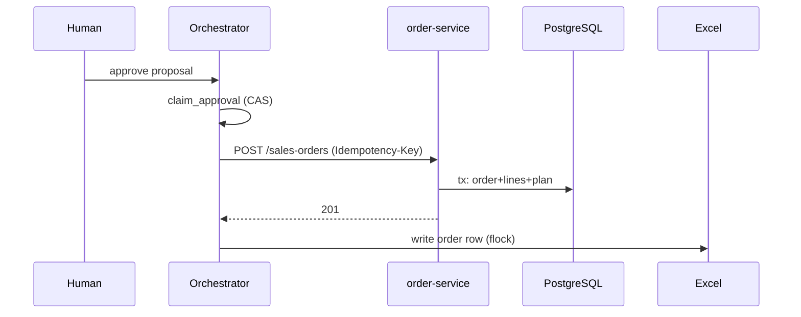

# Distributed-systems failure analysis

Static reading only. **No failure was injected.** Behaviors are INFERRED from code. Each should become a chaos test (see validation doc).

## What exists (VERIFIED)

Idempotency keys with request-hash mismatch; Redis plant lock with token, renewal, release scripts (fencing); atomic CAS for approvals; completion step ledger; HTTP retries with backoff in the orchestrator (`order_domain.py`, `manufacturing_services.py`); `publishTracked` which converts publish failure into a returned `DownstreamSyncError` instead of a 500.

## What does not exist (grep = 0)

Outbox, inbox, DLQ, circuit breaker, bulkhead, backpressure, rate limiting.

## Workflow 1: create sales order from agent (orchestrator → order-service → PG, then Excel)

| Failure point | Result (INFERRED) | Recoverable? |
|---|---|---|
| Orchestrator dies after CAS, before POST | Approval claimed, no order | Needs reclaim logic. **Not verified.** Stale-claim handling should be checked |
| O unreachable | Retried with backoff up to about 47 s, then fails | Idempotency key makes retry safe |
| Response lost after commit | Retry with same key returns original | Yes (hash check) |
| Excel write fails after PG commit | PG order exists, Excel lacks it | **No automatic reconcile** |

## Workflow 2: order update → reschedule (order-service → Kafka → scheduling consumer)

| Failure | Result | Recoverable? |
|---|---|---|
| Broker down at publish | `publishTracked` returns error; DB write stands; **event is lost** | No. No outbox. Schedule stays stale until someone reschedules |
| Consumer crashes mid-handler | kafkajs redelivers (at-least-once); handler may run twice | Depends on handler idempotency; **only breakdown handler reads an eventId; others unverified** |
| Poison message (bad JSON) | `JSON.parse` throws in `eachMessage` | Retried repeatedly; no DLQ, can stall that partition |
| Duplicate event | Reschedule runs twice | Mostly harmless (plant lock plus idempotent placement) but unproven |
| Two schedulers race | Plant lock with TTL; renewal; fenced release | Verified design; lock expiry during long run is mitigated by renewal |

## Workflow 3: production completion (mes-integration)

Atomic status claim, durable step ledger and fencing (commit `c4411eb`) make this the best protected path. Steps: claim → finished-goods receipt (inventory-service HTTP, idempotent) → fulfillment line update (HTTP) → billing (orchestrator, Excel).

| Failure | Result | Recoverable? |
|---|---|---|
| inventory-service down at receipt | Step recorded as pending/failed; resumable | Yes by design (INFERRED from step ledger) |
| Billing/Excel fails | Invoice missing; PG `Invoice` may lack row | Needs reconciliation job |
| Lease expires during step | Fencing rejects stale worker | Yes |

## Other observations

- **Retry storm risk**: orchestrator retries lack jitter confirmation and a circuit breaker; if order-service is slow, all agent runs hold workers for up to about 47 s.
- **Ordering**: single partition per topic keeps order per topic, but different topics (e.g., UPDATED vs BREAKDOWN) are unordered relative to each other.
- **Notification-service** replays can resend emails (no dedupe).
- **Exactly-once**: nowhere claimed in code. Keep it that way: aim for at-least-once plus idempotent handlers.

## Recommendation (only patterns that fix an observed failure)

| Pattern | Fixes | Do it? |
|---|---|---|
| Outbox | Lost event on publish failure | **Yes** |
| Inbox/dedupe | Duplicate effects | **Yes** |
| DLQ | Poison message blocking | **Yes** |
| Circuit breaker | Worker exhaustion in orchestrator | Yes, small (httpx wrapper) |
| Saga framework | none observed | **No**: step ledger suffices |
| Reconciliation job | Excel↔PG drift | **Yes** |
