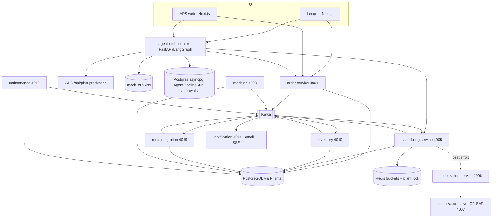

# System architecture: current state

## Style

**A distributed monolith around one shared database.** 18 Node/TS services (Express) plus a Python/FastAPI orchestrator share one PostgreSQL schema through `@aps/domain` (Prisma). Redis holds capacity buckets and the plant lock. Kafka (single partition per topic, `numPartitions: 1`) carries events. Two Next.js apps are the UIs. This is neither a clean modular monolith nor independent microservices, because every service can read nearly every table. The contract's G1 rule (no cross-domain writes) is the only boundary enforcement, and it is automated for one case (inventory writes).

## Service ownership (VERIFIED from baseline table and spot re-checks)

Writes by service: order-service (customer, salesOrder, orderLine, fulfillment*, productionOrder); scheduling-service (schedule*, scheduledOperation, resourceReservation, exceptions, quality); inventory-service (inventory, movements, PO, vendors); mes-integration (completion; inventory via HTTP); machine/maintenance/calendar/operator/tool services own their tables. Thin services (analytics, reporting, iot-ingestion, notification, routing, optimization) are 120 to 290 lines each with few or no tests.

## Assessment of decisions

| Decision | Verdict | Reason |
|---|---|---|
| One shared Postgres schema | **Good for now** | Cross-entity transactions are possible; no distributed-transaction problem inside Postgres |
| 18 deployable services over one DB | **Questionable** | Deployment cost without independent data. Several (calendar, tool, operator, analytics, reporting) could be modules. Consolidation is optional and not urgent |
| Single scheduler authority | **Good** | Contract B1; avoids divergence |
| Optional best-effort optimizer behind two hops | **Questionable** | Two services for one rarely-run solver; not deployable here; silently no-ops |
| LLM kept out of TS services; propose→approve | **Good** | Contract B2/C1/D1 |
| Excel as live system for post-sales | **Harmful at pilot scale** | Two sources of truth; flock-based locking cannot scale or span hosts |
| Kafka publish after commit, no outbox | **Harmful** | Lost events (see failure analysis) |
| Signed identity assertions, tenant from identity | **Good** | `identity.ts` HMAC, audience, 60 s TTL |
| Config-only docker/k8s never run | **Misleading** | Gives a false sense of deployability |
| Architecture contract in CI | **Good** | Rare discipline |

## Coupling hotspots

`pipeline.ts` is 1,877 lines and `agent-orchestrator/app/graph.py` is 3,322 lines. Both mix orchestration with decisions and are the hardest places to change safely.
