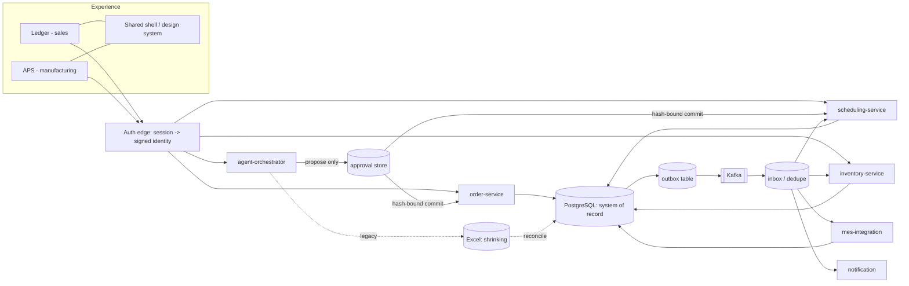

# Target product architecture (evolution, not rewrite)

Constraints: keep the shared Prisma domain, the single scheduler, the agent-orchestrator and both Next.js apps. Add no new microservice unless justified (none proposed).

## Changes, in order

1. **Outbox and inbox in `packages/shared`**: services write an `OutboxEvent` in the same transaction as the domain write; a relay publishes. Consumers record `(consumer, eventId)` in an inbox table; failures after N attempts go to a DLQ topic. This directly fixes G1/G2. Shared package, not a service.
2. **Single system of record per entity** (see [domain model](domain_model_and_bounded_contexts.md)). Postgres wins; Excel becomes import/legacy adapter and eventually a read-only mirror. Nightly reconciliation job as the first step.
3. **Reservation ledger**: `StockReservation` plus new `InventoryMovementType` values; `qtyReserved` becomes a derived/maintained value.
4. **Tenant model**: add `enterpriseId` to `Product` (or a per-enterprise product table), `siteId` scoping for plants. Required before a second factory/tenant.
5. **Scheduler**: keep `pipeline.ts` as authority. Add benchmark harness, then sequence-dependent setup; evaluate CP-SAT only as a *verified* refinement (feasibility re-checked by `schedule-validator.ts`).
6. **Observability**: OpenTelemetry in `packages/shared` and the orchestrator; Prometheus metrics endpoint; health/readiness uniform.
7. **Experience**: shared design tokens/component package; an order lifecycle timeline and an exception command center served from existing APIs; apps stay separate.
8. **Agents**: propose-only; eval harness; prompt/model version recorded per run.

## Explicitly not in the target

More microservices, event sourcing, CQRS, a service mesh, a custom workflow engine, Kubernetes as a prerequisite (manifests exist but are unrun), LLM-driven scheduling.
